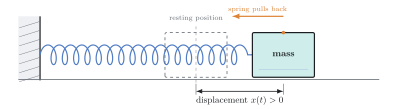

import MassSpring from '../../../components/control/MassSpring.astro';

Imagine we give a dynamic system a brief disturbance, then stop touching it. A temperature difference fades. A suspended weight swings. A glass rings. The resulting motion is not usually arbitrary: systems tend to respond in recognizable patterns. We call one such characteristic pattern a **mode**. This is an intuitive definition that we will refine later.

Modes matter in control because every command, disturbance, and feedback correction can excite them. A well-designed controller makes unwanted motion fade. A poorly designed controller may allow it to ring for too long, or may even cause it to grow. Some modes simply fade or grow without oscillating.

Richer motions can be composed from simpler modal contributions, each with its own amplitude, phase, frequency, and rate of decay or growth. Later we will learn when and why such a decomposition is possible. First, let us consider a single oscillatory mode and understand it fully.

## A mass-spring oscillator

Imagine a weight attached to a spring on a smooth table where we pull the weight to the right and release it. We expect it to slide through its resting position, compres the spring on the other side, reverse direction, and repeat.

Call the weight's displacement from its resting position $x(t)$. In the picture below, the pale outline marks the resting position $x=0$. The solid weight has been pulled to the right, so $x(t)>0$. The stretched spring pulls left, toward equilibrium; after release, the weight's inertia will carry it through the center.

<figure>

<figcaption>Pulling the mass away from equilibrium stores energy in the spring. The spring accelerates the mass back toward the center, while the mass's inertia carries it onward.</figcaption>
</figure>

Now focus on one position slightly to the right of center. The weight passes through that same position twice during every cycle: once while moving left and once while moving right. Its position is identical at those two instants, but what happens at the next time step is different because the velocities differ. Position alone is therefore not enough to describe the motion. We also need its velocity.

At either extreme, the weight momentarily stops before reversing, so its velocity is zero. At the resting position, its speed is greatest. The state repeatedly cycles through combinations of position and velocity. If no energy were lost, a suitably scaled plot of these two coordinates would form a circle. Friction removes a little energy on every cycle, so the loop becomes an inward spiral. In the position trace, oscillation and decay are superimposed; in the two-coordinate view, they separate into turning around the origin and shrinking toward it.

Below, the same motion is drawn three ways at once: the mass itself, its position over time, and its position against its (scaled) velocity. The slider $\sigma$ is the decay rate: it sets how fast friction shrinks the size of the swing. Negative $\sigma$ means the motion dies out, and the more negative it is, the faster. We define it properly in the next section. Things to try:

- Watch the mass and the spiral together. The mass is at an extreme - momentarily stopped - exactly when the spiral crosses the horizontal axis, and passes through the center when the spiral crosses the vertical axis.
- Drag $\sigma$ to zero. Nothing removes energy any more, so the spiral closes into a circle and the envelope in the time plot goes flat.
- Raise the frequency with $\sigma$ fixed. More cycles fit into the same time, so each turn of the spiral shrinks less: how much a mode decays per cycle depends on $\sigma$ relative to its frequency.

<MassSpring />

## The modal waveform

The time plot is the history of one oscillatory mode. Let us build its description one step at a time. Begin with

$$
\cos(\omega t+\phi).
$$

The angular frequency $\omega$ determines how quickly the motion cycles, while the phase $\phi$ determines where in that cycle the motion begins. Multiplying by a positive number $A_0$, the amplitude at time zero, sets the initial size of the oscillation's envelope. Finally, multiplying by the real exponential $e^{\sigma t}$ allows that envelope to change with time. Together these pieces give

$$
x(t)=A_0e^{\sigma t}\cos(\omega t+\phi).
$$

If $\sigma<0$, the envelope shrinks; if $\sigma=0$, its size remains constant; and if $\sigma>0$, it grows. The spring is only one physical realization of this pattern. Whenever a single growing, decaying, or persistent oscillation appears, the same four parameters can describe its time history.

## The state plane

The position-velocity plot should not be mistaken for physical space. Position and velocity even have different units; we draw them along perpendicular directions on the page simply to keep two independent pieces of information visible. For the spring, suitably scaled position and velocity uniquely determine its state in the cycle. For another oscillatory mode, the useful coordinates may represent different physical quantities. What generalizes is that one oscillation has both a size and a place in its cycle. Those two numbers can be drawn as the radius and angle of a point in a plane.

[Complex numbers](/notes/control/complex-numbers/) will turn this expression from a collection of factors into one geometric motion. Amplitude will become distance from the origin, phase will become starting direction, frequency will become turning rate, and growth or decay will become radial expansion or contraction.

The state picture suggests the algebra we would like to have. We want one object that keeps both coordinates together. Advancing an ideal oscillator through a quarter-cycle should rotate that object by $90^\circ$. Damping should shrink its distance from the origin. If rotation and scaling can be expressed as ordinary algebra, then oscillation and decay become much easier to describe.
