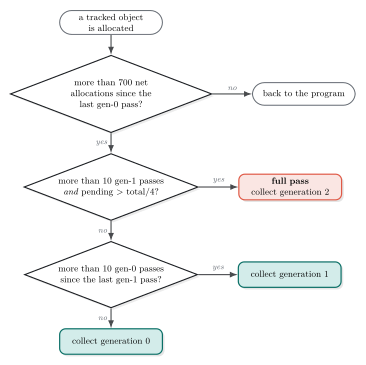
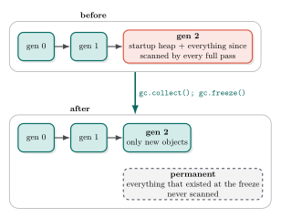

import GcStepper from '../../../components/python/GcStepper.astro';
import GcSimulator from '../../../components/python/GcSimulator.astro';
import GilStall from '../../../components/python/GilStall.astro';
import GcStallTrace from '../../../components/python/GcStallTrace.astro';

Most of the time, we never think about how Python frees memory. That changes in large Python services, which can suffer seemingly random stalls of tens to hundreds of milliseconds. In safety-critical applications this matters (though safety-critical software arguably shouldn't be written in Python :) ). I've run into this problem twice in my career, on two entirely different systems. It's a pain to debug, and usually the only way to find it is by process of elimination. If that sounds familiar, the cause may be the CPython garbage collector.

This note introduces Python's memory model and covers what to know if you have the misfortune of building large Python applications.

In this note, we assume CPython 3.8.

## Two ways to free memory

Languages free memory in one of two ways. With explicit freeing, the programmer releases each allocation by hand, as with `free()` in C or `delete` in C++. This makes the release point explicit, but a forgotten free leaks memory and uncareful management can corrupt memory and crash programs. With implicit freeing, the runtime decides when an object is no longer needed and frees it for us, as in Java, Go and Python. This removes a whole class of bugs, but the programmer no longer controls when the work of freeing happens. Python frees memory implicitly, and CPython does it with two separate mechanisms.

**Reference counting.** Objects carry a count of how many references point to them. Normally, when the count drops to zero, the object is freed at that moment. This frees almost everything: messages, temporary lists, dicts, strings. It runs all the time and cannot be turned off through `gc`. It avoids a heap-wide scan, though freeing a large object graph or running a destructor can still take time.

**The cyclic garbage collector.** Reference counting has one blind spot: objects that point to each other in a loop. Each keeps the other's count above zero, so neither is ever freed. The `gc` module exists to handle identification and release of these loops. We can create such a loop with the following program:
```python
class Node: pass
a, b = Node(), Node()
a.peer, b.peer = b, a     # a loop
del a, b                  # both counts are still 1
import gc; gc.collect()   # the collector finds the loop and frees both
```

Below we will go into depth regarding the second mechanism.

## Tracked objects

Only objects that can hold references to other objects can be part of a loop, so only those are **tracked**: lists, dicts, sets, tuples, class instances, functions, modules, frames and similar containers. Plain values such as `int`, `float`, `str` and `bytes` are never tracked. CPython also stops tracking dicts and tuples that hold only plain values.

In a typical scientific or robotics service, most tracked objects come from imports - numpy, scipy, OpenCV, gRPC, protobuf. A few hundred thousand of them is normal, and they live as long as the process does. Large native buffers, such as numpy arrays' data, are not traversed by the cyclic collector; whether their Python wrappers are tracked depends on the type.

## How does the garbage collector find garbage?

A collection looks at one group of tracked objects and asks which of them are still reachable from outside the group. It does not know where the outside references are, so it works them out:

1. **Copy** each object's reference count into a scratch counter, `gc_refs`.
2. **Subtract** one for every reference that starts inside the group. What is left is the number of references from outside.
3. **Mark.** Any object with `gc_refs` above zero is referenced from outside, so it is alive. Everything it can reach is alive too.
4. **Free** the rest. They refer only to each other. The collector runs finalizers, clears weak references, and breaks the loops so that reference counting can free them.

After step 2,

$$
\texttt{gc\_refs}(x) = \texttt{refcount}(x) - \bigl|\{\,y \in \text{group} : y \to x\,\}\bigr|.
$$

Here "outside" means anything not in the group, such as a local variable on some thread's stack, a module global, or an object in an older generation. Use the interactive visual below to step through the collection process:

<GcStepper />

Finding garbage requires visiting the objects in the group and traversing their references. A collection over millions of objects visits all of them, even when it frees only a few hundred. That is the runtime cost we care about.

## Generations

A **generation** is one of three internal lists. Every non-frozen tracked object is in exactly one of them, according to how many collections it has survived.

The idea behind it is that most objects die young - a message is parsed, used and dropped within milliseconds - and objects that survive a while usually live a long time. So CPython scans young objects often and old objects rarely.

| Generation | Holds | A collection of it scans | Survivors move to |
|---|---|---|---|
| 0 | new objects | generation 0 | generation 1 |
| 1 | objects that survived one collection | generations 0 and 1 | generation 2 |
| 2 | everything older | all three: a **full pass** | stay in generation 2 |
| permanent | objects frozen by `gc.freeze()` | never scanned | - |

Collections of generations 0 and 1 are usually smaller and faster, though their duration is not bounded. A full pass walks the whole tracked heap, so with a large heap it costs tens of milliseconds of CPU.

## When does a collection occur?

Collections are triggered by allocations, inside whichever thread happens to allocate a tracked object. The thresholds come from `gc.get_threshold()`, which defaults to `(700, 10, 10)`.

<figure>

<figcaption>The check that runs on every tracked allocation. The generation-2 test counts generation-1 passes since the last full pass.</figcaption>
</figure>

Two counters guard the full pass:

- `long_lived_total` is the number of objects in generation 2 right after the last full pass.
- `long_lived_pending` is the number of objects that have moved into generation 2 since then.

A full pass runs only when

$$
n_{\text{gen-1 passes}} > 10 \quad\text{and}\quad \texttt{long\_lived\_pending} > \tfrac{1}{4}\,\texttt{long\_lived\_total}.
$$

So generation 2 must grow by more than 25% since the last full pass. The rule keeps a large, stable heap from being rescanned over and over. It also means the gap between full passes grows with the heap.

## Why does a full pass stall the process?

Python threads in the same interpreter share one lock, the **GIL**, and only the thread that holds it runs Python code. Normally the interpreter aims to hand it to a waiting thread every 5 ms though this isn't guaranteed.

The collector's heap traversal is C code that runs while holding the GIL, so all other threads that need to execute Python code must wait.

Load makes it worse. If the operating system takes the CPU away from the collecting thread in the middle of a pass, the thread keeps the GIL while it waits. If $p$ is the share of a CPU the thread gets,

$$
t_{\text{wall}} \approx \frac{t_{\text{CPU}}}{p}.
$$

A 70 ms pass on a machine where the thread gets a quarter of a core can stall Python execution for roughly 280 ms. Below, thread 1 triggers a full pass at 120 ms. The other threads, and the heartbeat on thread 2, wait until it ends.

<GilStall />

## What gc.freeze() does

`gc.freeze()`, added in Python 3.7, moves every currently tracked object into a fourth, **permanent** generation that collections never scan.

<figure>

<figcaption>Freezing at the end of startup takes the startup heap out of every later full pass.</figcaption>
</figure>

From then on:

- **Frozen objects are not scanned.** A full pass walks only objects created after the freeze, so it costs a fraction of what it did.
- **Frozen objects are still freed by reference counting.** If the last reference to one goes away, it is freed at once.
- **New objects are collected normally.**
- **The trigger does not move at first.** In 3.8, `gc.freeze()` does not reset `long_lived_total`. The first full pass after the freeze still waits for 25% of the old heap size, but it scans only the new objects. That pass then sets `long_lived_total` to the small unfrozen part of generation 2, so later full passes can come sooner. Their size depends on how much new state accumulates.

What it gives up: if objects that existed at the freeze later form a loop that becomes garbage, that loop can remain allocated until it is unfrozen and collected. Calling `gc.collect()` just before `gc.freeze()` removes the garbage that exists at that moment. This works best when the remaining startup objects are expected to live as long as the process anyway.

```python
# end of startup, before the service starts its threads
import gc
gc.collect()             # free startup garbage first
gc.freeze()              # the startup heap is never scanned again
gc.get_freeze_count()    # how many objects are frozen
```

To undo the freeze, call `gc.unfreeze()` to move the objects back into generation 2.

The freeze covers only objects that exist when it runs. Objects created later still move into generation 2, and every later full pass scans them. If a service creates a burst of long-lived objects at a known moment - loading a map, starting a job - a second `gc.collect(); gc.freeze()` right after it removes the burst too, at a moment we choose.

The simulator below runs the real 3.8 trigger rule on a 250,000-object startup heap. Pauses assume 0.25 µs per scanned object. Things to try:

- Leave it at 600× and wait for the first full pass. Then press `gc.freeze()`, add a burst, and compare the next full pass.
- Press `gc.collect()` and then `gc.freeze()`. Watch the trigger in the status line: it stays at a quarter of the old heap until the next full pass.
- Raise the long-lived share. More of generation 0 survives into generation 2, so full passes come more often.

<GcSimulator />

## Reproducing the stall

The simulator is a model. To see the real thing, I built a process that looks like a long-running service: five million long-lived tracked objects, a heartbeat thread that wakes every 5 ms, and a main loop that adds about 40,000 long-lived objects per second while churning through short-lived ones. A `gc.callbacks` hook times every collection, and the heartbeat thread records when it actually ran. The script runs twice: once as is, and once with `gc.collect(); gc.freeze()` right after the heap is built.

I ran it on my laptop (Apple M4 Pro, Python 3.12, whose collector follows the same rules as 3.8 here). The script is [here](/notes/python-internals/gc_stall_demo.py); pass it a filename to save the raw data.

<GcStallTrace />

- For the first 33 seconds no full pass happens. About 2,500 small collections run, and the heartbeat ticks every 6 ms. Then generation 2 crosses the 25% trigger, and one full pass scans more than six million objects in 213 ms. The heartbeat thread is silent for that whole window - zoom in to see the heartbeats stop.
- With the freeze, the first full pass comes at almost the same time, because the trigger did not move. But it scans only the 1.3 million objects created since startup, and takes 55 ms.
- That pass resets `long_lived_total` to the small unfrozen part of generation 2, so the second full pass comes only 8 seconds later, and is just as small.

## Where loops come from

Loops are common in normal code, and none of them is a bug. They matter only because each one waits for a collection instead of being freed at once.

- **Exceptions.** A caught exception keeps its traceback, which refers to the frame, which refers to the exception if it is stored in a local variable.
- **Callbacks.** An object that stores its own bound method, or a closure that refers to the object holding it.
- **Parent and child links.** Trees, graphs and doubly linked structures where a child refers back to its parent.
- **Threads and async code.** Futures, tasks and their callbacks often refer to each other.

A weak reference (`weakref.ref`) breaks such a link when only one side needs to own the other.

## The gc module

| Call | What it does | Cost |
|---|---|---|
| `gc.collect(generation=2)` | Run a collection now. Returns the number of unreachable objects found. | A full pass: the non-frozen tracked heap |
| `gc.freeze()` / `gc.unfreeze()` | Move all tracked objects to the permanent generation, or back. | Cheap |
| `gc.disable()` / `gc.enable()` | Stop or restart automatic collections. Reference counting still runs. | Free |
| `gc.set_threshold(700, 10, 10)` | Change when collections trigger. | Free |
| `gc.get_count()` | Current counters for the three generations. | Free |
| `gc.get_stats()` | Collections, collected and uncollectable objects per generation. | Free |
| `gc.callbacks` | Functions called with `"start"` and `"stop"` around every collection. Useful for timing them. | Two calls per collection |
| `gc.get_objects()` | A list of every tracked object. | Slow: walks everything |
| `gc.is_tracked(obj)` | Whether one object is tracked. | Free |
| `gc.garbage` | Objects the collector could not free. Rare since Python 3.4. | Free |
