## Overview

In traditional Simultaneous Localization and Mapping (SLAM), the objective is to incrementally build a consistent map of the environment while simultaneously estimating the robot's trajectory within it. Most SLAM systems assume that exploration is either manually guided or carried out via random or predefined motion, leaving autonomous data collection largely unaddressed. Active SLAM instead generates actions that explore efficiently while reducing map and pose uncertainty.

Classical Active SLAM separates the process into generating candidate actions, scoring their expected utility (such as expected information gain), and executing the best one (Stachniss et al. 2005). Frontier-based methods pick paths along the boundary between known and unknown space using utility functions over geometry and prior observations (Baek et al. 2025). Both rely on handcrafted utilities that generalize poorly to unseen environments and perceptual aliasing. Learned approaches exist - a Dueling Double DQN with a D-optimality reward (Placed and Castellanos 2020), and point-goal exploration policies (Chaplot et al. 2020) - but the latter often ignore SLAM uncertainty, operating in known maps or with oracle localization.

We train a policy that selects high-level navigation goals and relies on a classical planner to execute it with a reward that values both map coverage and pose-graph certainty. Trained on exploration, the agent maps a simulated environment in an average of 7 goals - on par with a human expert who already knows the map, and far better than random goal selection, which needs about 30. A discrete-action DQN agent matches this in a tenth of the training. Learning when to deliberately revisit places to close loops proved harder, though we describe what we found and why.

<figure id="fig:system">
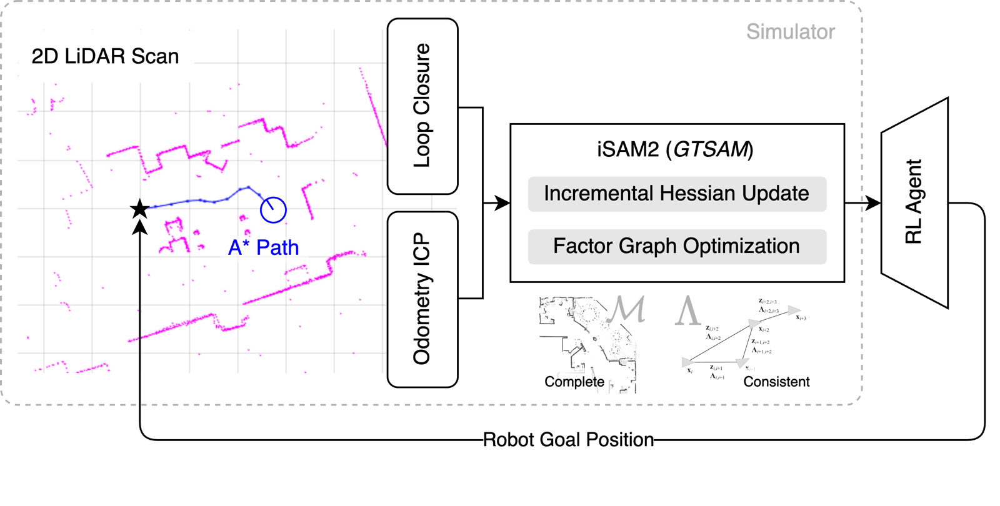
<figcaption><strong>Figure 1.</strong> The Active SLAM framework. A reinforcement learning agent chooses goal positions to maximize both map coverage and map consistency through a dual-objective reward. Residuals and information from the iSAM2 solver provide the reward signal.</figcaption>
</figure>

## Graph-Based SLAM

Graph-based SLAM optimizes a factor graph in which each node is a robot pose and each factor is a probabilistic constraint between poses, arising either from odometry or from loop-closure detections. Given poses $\mathcal{X} = \{x_0, x_1, \ldots, x_T\}$ and measurements $\mathcal{Z} = \{z_{i,j}\}$ relating poses $i$ and $j$, the problem seeks the poses that maximize the likelihood of the measurements:

$$
\mathcal{X}= \mathop{\mathrm{arg\,max}}_{\mathcal{X}\in SE(n)} p(\mathcal{Z}\mid \mathcal{X}) =
\mathop{\mathrm{arg\,min}}_{\mathcal{X}\in SE(n)}  \sum_{(i,j)} \left\lVert h(x_i, x_j) - z_{i,j} \right\rVert^2_\Sigma, \tag{1}
$$

where $\left\lVert \cdot \right\rVert^2_\Sigma$ is the squared Mahalanobis distance under the measurement covariance $\Sigma$, and $h$ is the measurement function.

Our robot is planar, operating in $SE(2)$, with a 2D lidar that measures range and bearing over a full $360^\circ$. Odometry factors come from 2D Iterative Closest Point (ICP) scan matching. Loop-closure candidates are found by searching previous poses within a 4 m radius of the latest one that observe similar geometric features, and ICP then estimates the transformation between them. Odometry error makes the global poses drift over time; loop-closure constraints pull them back into global consistency. We solve the problem online with the incremental iSAM2 optimizer (Kaess et al. 2011) in GTSAM (Dellaert and Contributors 2022).

The *Hessian*, or information matrix, of problem (1) is

$$
\Lambda = \sum_{(i,j)} J_{i,j}^T \Sigma^{-1} J_{i,j}, \tag{2}
$$

where $J_{i,j}$ is the Jacobian of the residual $h(x_i, x_j) - z_{i,j}$ with respect to $\mathcal{X}$. Its block structure mirrors the connectivity of the pose graph (Placed and Castellanos 2023), which makes norms of $\Lambda$ meaningful measures of how well the graph is constrained - and a natural ingredient for a reward.

<figure class="added">
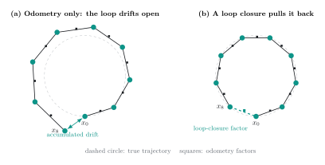
<figcaption><strong>Figure 2.</strong> Odometry alone lets error accumulate around a loop (a). A loop-closure factor between the first and last poses (b) constrains the whole chain; in the Hessian $\Lambda$ it appears as an off-diagonal block, which raises $\log\det\Lambda$.</figcaption>
</figure>

## Method

Learning motor commands for exploration directly would make the reward extremely sparse and the horizon long. We instead split planning into two levels: the RL policy outputs a goal waypoint, and a classical $A^*$ planner routes the robot there, integrating sensor data along the way to update the SLAM estimate and occupancy map. This lets the policy reason over long horizons without having to learn long-horizon credit assignment - at each query it acts more like a contextual bandit, choosing either an exploration goal or a loop-closure goal. We compare a continuous action, where the policy chooses any $(x, y)$ goal, with a discrete choice among $k$ sampled goals, inspired by classical frontier-based exploration.

The agent observes:

- the occupancy grid map built from the scans at the pose-graph nodes,
- a one-hot image of its current position in that map,
- the marginal information of each pose in the pose graph, projected onto the map,
- and, for the discrete variant, the $k$ candidate goals.

The reward combines both objectives:

$$
\mathcal{R}= \lambda_{\mathrm{explore}}
\left(
\frac1{|\mathcal{M}|}
\Delta H_t
\right) +
\lambda_{\mathrm{closure}} \Delta \log(\det \Lambda_t). \tag{3}
$$

The first term is the change in entropy of the occupancy grid $\mathcal{M}$, normalized by its size, where each cell $\mathcal{M}^i$ is an independent Bernoulli occupancy variable:

$$
H_t = -\sum_{\mathcal{M}} p_i \log(p_i), \qquad p_i \sim \mathrm{Bernoulli}(\mathcal{M}^i). \tag{4}
$$

The second term is the change in the log-determinant of the SLAM Hessian (2). As informative loop closures enter the pose graph, $\Lambda$ gains significant off-diagonal terms that constrain the least-squares solution and make the map consistent. Together, the two terms reward information gain in two modalities - in the map, through exploration, and in the pose graph, through loop closures - with $\lambda_{\mathrm{explore}}$ and $\lambda_{\mathrm{closure}}$ setting the balance between these often competing objectives.

We train with PPO (Schulman et al. 2017) for the continuous action and DQN (Mnih et al. 2013) for the discrete one, using the Stable Baselines 3 implementations (Raffin et al. 2021), with a convolutional encoder followed by an MLP for the actor and critic.

The ideal action distribution here is inherently multimodal: a robot entering a hallway may gain just as much by turning left as by turning right. A discrete Q-learning policy captures this naturally through its categorical distribution, whereas the unimodal Gaussian policies of PPO or SAC cannot - which turns out to matter.

## Results

### Reward Evaluation

We first checked that each reward term responds to the behavior it is meant to encourage. For loop closures, we built a toy SLAM problem with nine poses in a figure-eight, visiting two locations twice, and varied how many loop closures enter the optimization. Each additional closure adds visible off-diagonal blocks to the Hessian and increases $\log\det\Lambda$ (Fig. 3). For exploration, we confirmed that the average cell entropy of the occupancy grid decreases as the map is explored.

<figure id="fig:hess">
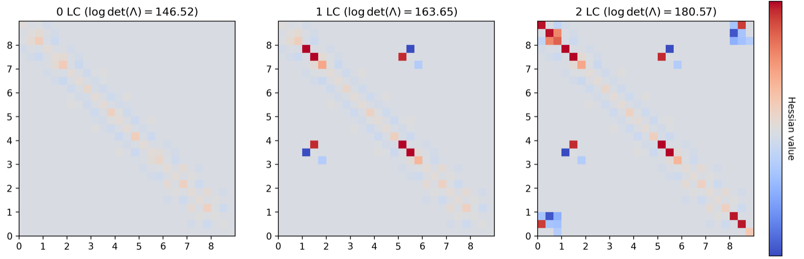
<figcaption><strong>Figure 3.</strong> SLAM Hessians $\Lambda$ after optimization for nine poses in a figure-eight with noisy odometry, with 0, 1, and 2 loop closures, showing their effect on the Hessian's structure and log-determinant.</figcaption>
</figure>

### Exploration

With only the coverage term and a time penalty, the agent learns to map the environment as quickly as possible - a setting we also used to validate every part of our custom simulator: occupancy grid creation and updates, the $A^*$ planner, and the RL parameters. With a continuous action, PPO chooses any $(x, y)$ goal; goals outside the free space the agent has already seen are rejected with a negative reward, to avoid planning through unknown space. After $3 \cdot 10^6$ environment steps, the agent reaches an average episodic reward of 13 and an episode length of 7 goals, on par with expert human performance - the human experts being the authors, who know the map geometry in advance. A random goal selector averages a reward of −12 over 30 goals. Fig. 4 steps through one episode.

<figure id="fig:exploration_sequence_full" class="steps">
<figure>
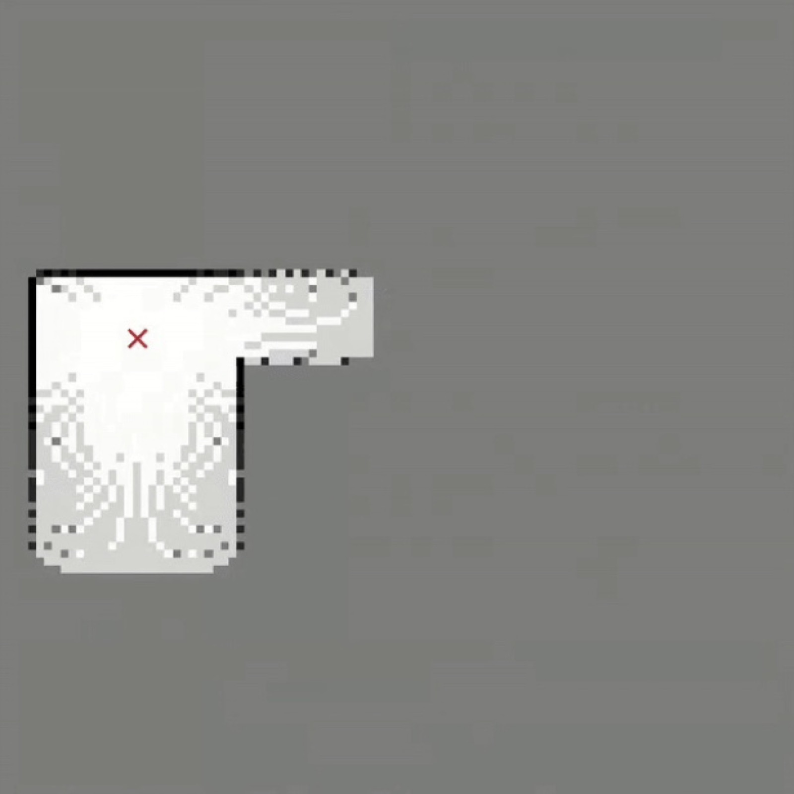
<figcaption>Step 0</figcaption>
</figure>
<figure>
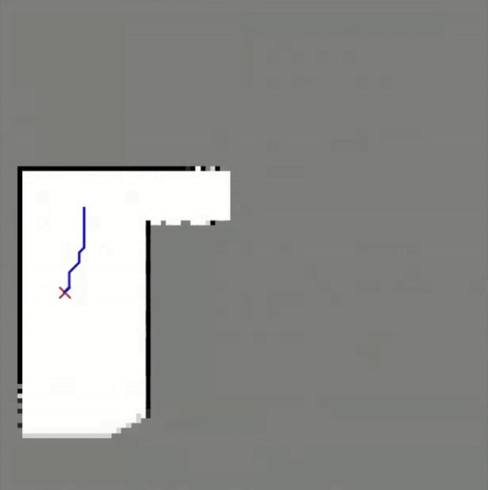
<figcaption>Step 1</figcaption>
</figure>
<figure>
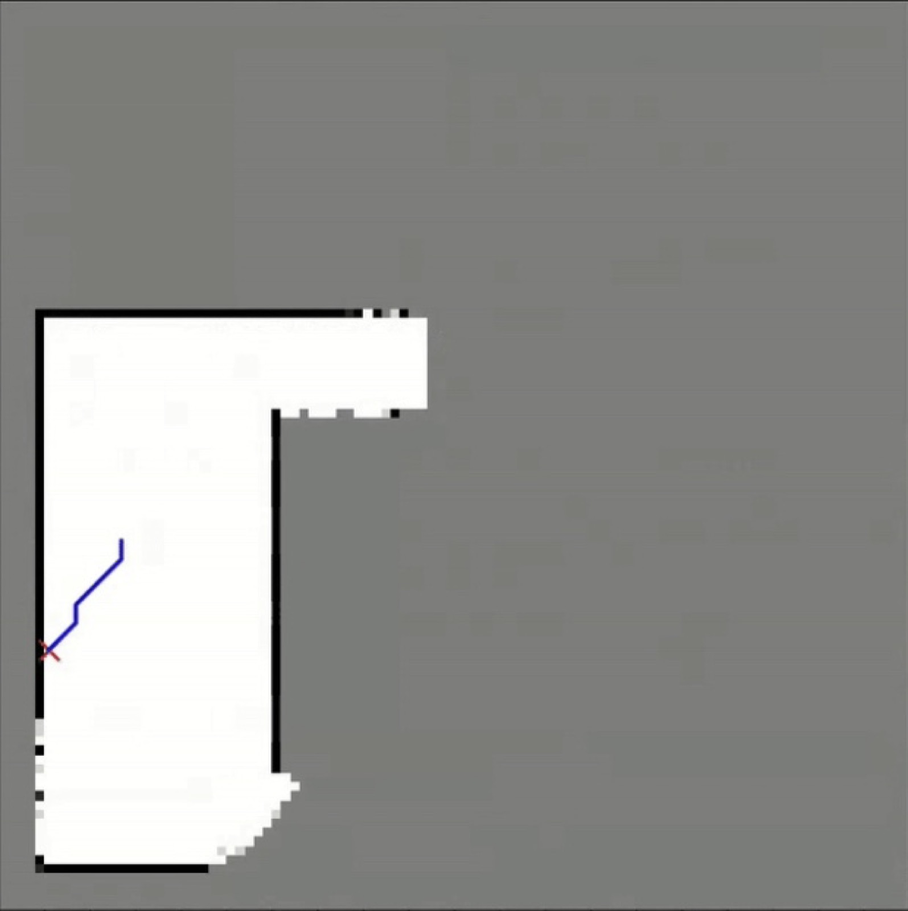
<figcaption>Step 2</figcaption>
</figure>
<figure>
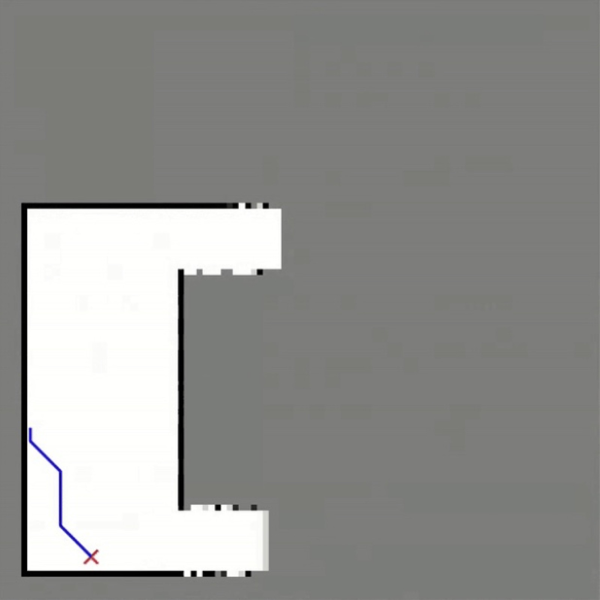
<figcaption>Step 3</figcaption>
</figure>
<figure>
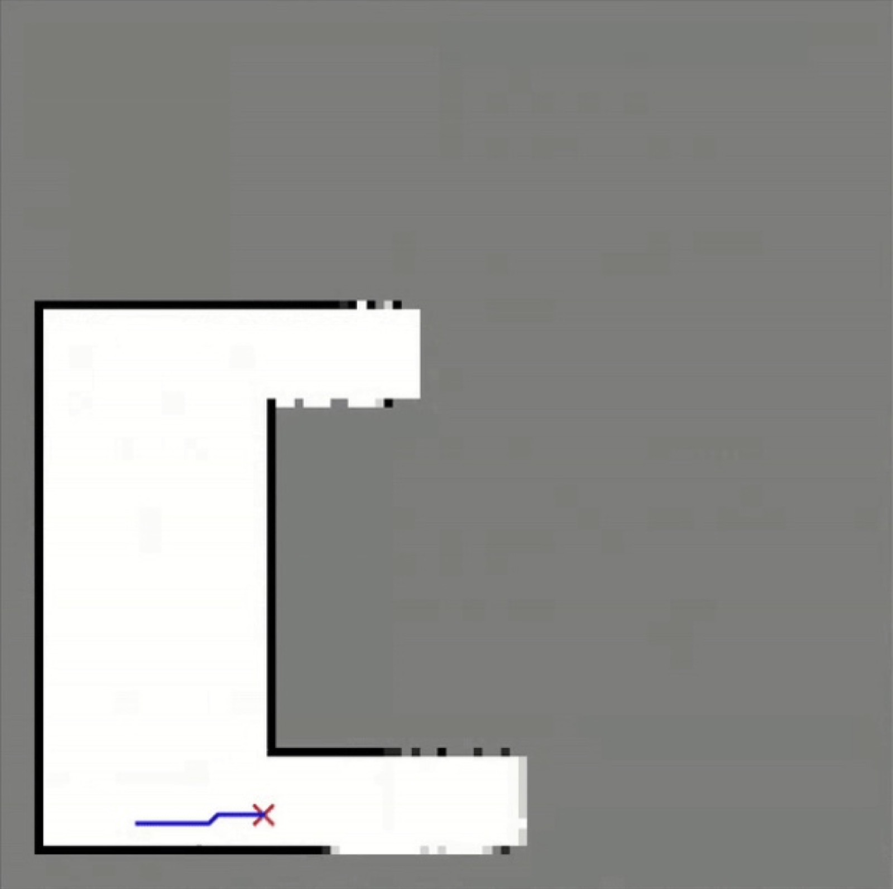
<figcaption>Step 4</figcaption>
</figure>
<figure>
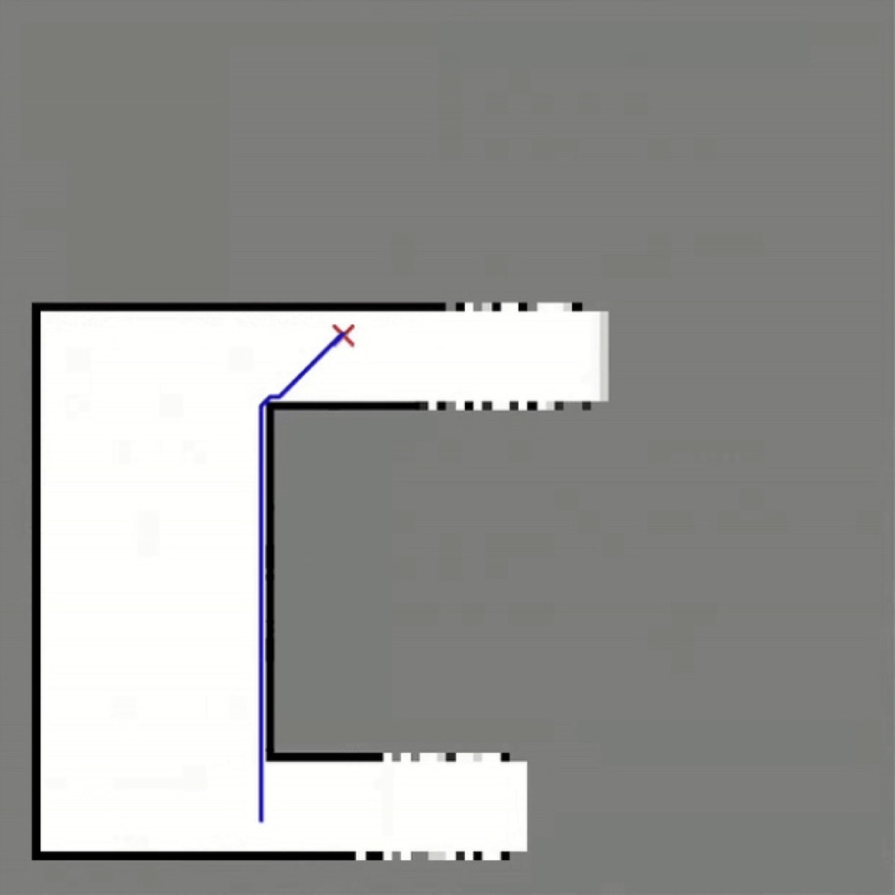
<figcaption>Step 5</figcaption>
</figure>
<figure>
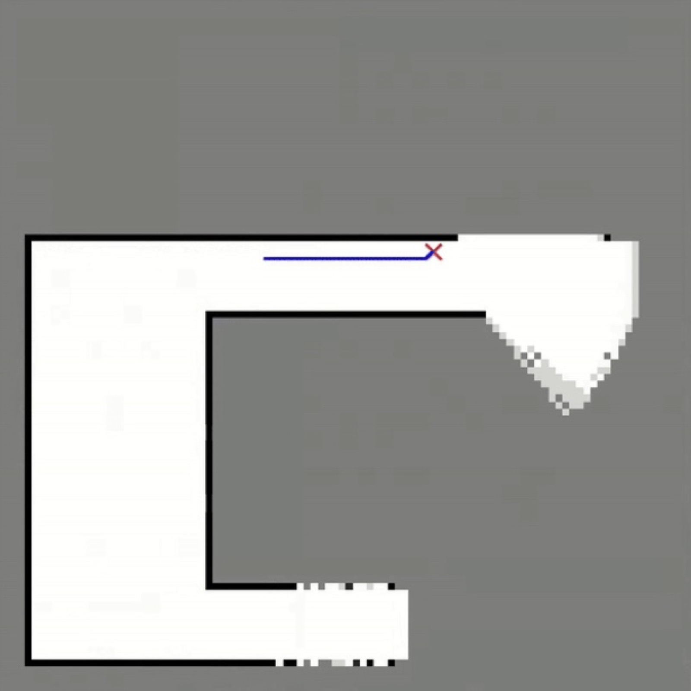
<figcaption>Step 6</figcaption>
</figure>
<figure>
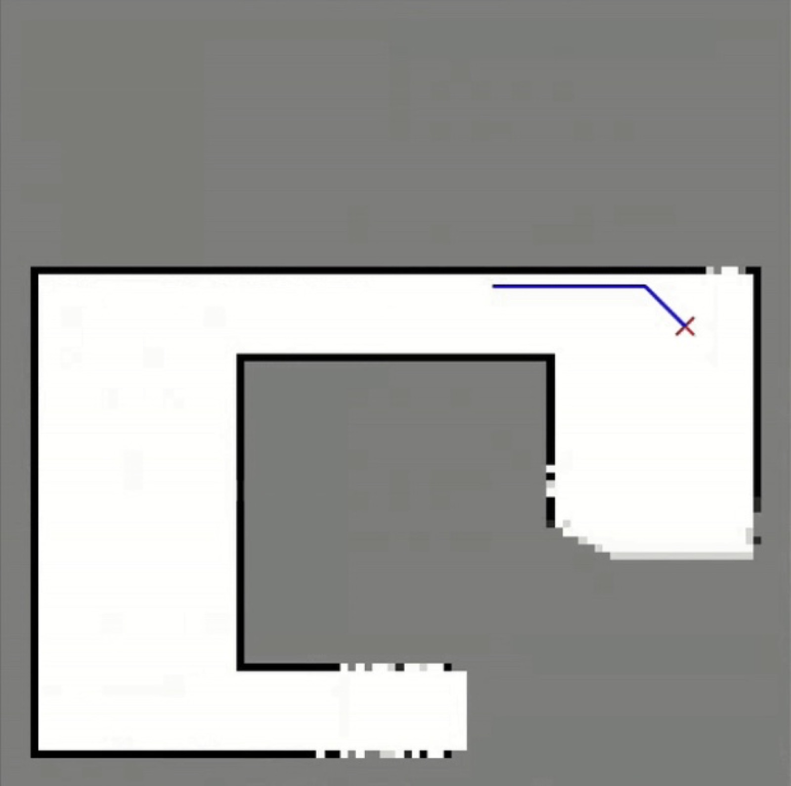
<figcaption>Step 7</figcaption>
</figure>
<figure>
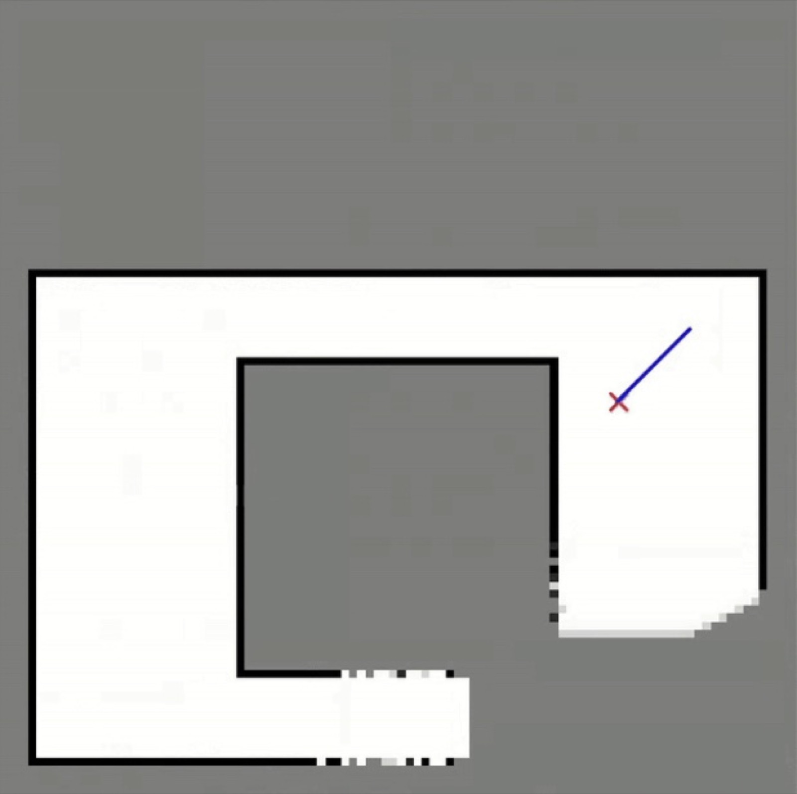
<figcaption>Step 8</figcaption>
</figure>
<figure>
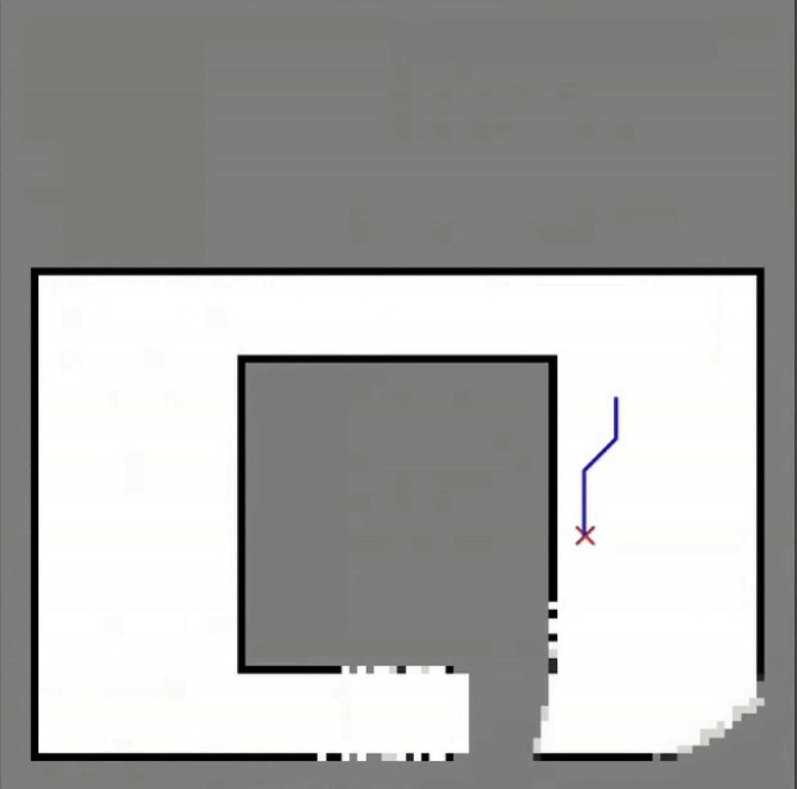
<figcaption>Step 9</figcaption>
</figure>
<figcaption><strong>Figure 4.</strong> A ten-step episode of learned exploration in a simulated 2D environment. Red crosses are the policy's high-level goals; blue lines are the planner's trajectories.</figcaption>
</figure>

To make learning easier, we also discretized the action and trained with DQN, which is often more sample-efficient than PPO, easier to train, and - unlike PPO's unimodal Gaussian - can represent multimodal action distributions. We tried two discretizations: choosing among $k$ sampled frontiers between explored and unknown space, as in classical frontier exploration (Baek et al. 2025), and choosing among $k$ sampled free-space cells, which is cheaper since it needs no frontier detection. With the same network backbone, both match PPO's performance in only $3 \cdot 10^5$ environment steps - **a tenth of the training**.

### Exploration and Loop Closure Together

With the full reward (3), the agent must not only expand the known free space but also revisit previously seen regions to reduce drift through loop closures. Trained with PPO and a convolutional encoder over the map, position, and marginal-information channels, the learned policies did not exhibit meaningful loop-closure behavior, and training was unstable.

We see two likely causes. First, the marginal-information map may be too coarse or indirect a signal to capture the full structure of pose-graph constrainedness, especially in ambiguous or symmetric environments. Second, a unimodal policy struggles to represent several equally promising behaviors - revisiting one of several loop-closure candidates, or continuing to explore - and the sparse loop-closure reward makes this harder still.

## What Comes Next

Each of these causes suggests a direction:

- **Multimodal policies.** Generative policy architectures - diffusion-based actors (Ma et al. 2025) or energy-based normalizing flows (Chao et al. 2024) - model multimodal action distributions directly, and some draw on the same entropy-regularized framework as SAC.
- **Richer pose-graph observations.** Learned embeddings from graph neural networks, or spectral descriptors of the information matrix, could expose the graph's structure far better than a projected heatmap.
- **Temporally extended behavior.** The Option-Critic architecture (Bacon et al. 2017) learns high-level behaviors, their internal policies, and when to switch between them end-to-end, which could produce distinct exploration and loop-closure options.
- **Sample efficiency.** Every simulated episode runs SLAM optimization, map updates, and planning, so off-policy methods such as SAC (Haarnoja et al. 2018) with better sample reuse are attractive.
- **Unbounded environments.** The current fixed-size map and observation limit scalability; transformer-based policies with memory could reason over dynamically sized graphs and maps.

## References

Bacon, Pierre-Luc, Jean Harb, and Doina Precup. 2017. “The Option-Critic Architecture.” *Proceedings of the AAAI Conference on Artificial Intelligence* 31.

Baek, Seungjae, Brady Moon, Seungchan Kim, et al. 2025. “PIPE Planner: Pathwise Information Gain with Map Predictions for Indoor Robot Exploration.” *arXiv Preprint arXiv:2503.07504*. <https://arxiv.org/abs/2503.07504>.

Chao, Chen-Hao, Chien Feng, Wei-Fang Sun, Cheng-Kuang Lee, Simon See, and Chun-Yi Lee. 2024. “Maximum Entropy Reinforcement Learning via Energy-Based Normalizing Flow.” *arXiv Preprint arXiv:2405.13629*.

Chaplot, Devendra Singh, Dhiraj Gandhi, Saurabh Gupta, Abhinav Gupta, and Ruslan Salakhutdinov. 2020. “Learning to Explore Using Active Neural SLAM.” *International Conference on Learning Representations (ICLR)*.

Dellaert, Frank, and GTSAM Contributors. 2022. *Borglab/Gtsam*. V. 4.2a8. Georgia Tech Borg Lab, released May. <https://doi.org/10.5281/zenodo.5794541>.

Haarnoja, Tuomas, Aurick Zhou, Pieter Abbeel, and Sergey Levine. 2018. “Soft Actor-Critic: Off-Policy Maximum Entropy Deep Reinforcement Learning with a Stochastic Actor.” *International Conference on Machine Learning (ICML)*, 1861–70.

Kaess, Michael, Hordur Johannsson, Richard Roberts, Viorela Ila, John Leonard, and Frank Dellaert. 2011. “iSAM2: Incremental Smoothing and Mapping with Fluid Relinearization and Incremental Variable Reordering.” *2011 IEEE International Conference on Robotics and Automation*, 3281–88. <https://doi.org/10.1109/ICRA.2011.5979641>.

Ma, Haitong, Tianyi Chen, Kai Wang, Na Li, and Bo Dai. 2025. “Soft Diffusion Actor-Critic: Efficient Online Reinforcement Learning for Diffusion Policy.” *arXiv Preprint arXiv:2502.00361*.

Mnih, Volodymyr, Koray Kavukcuoglu, David Silver, et al. 2013. “Playing Atari with Deep Reinforcement Learning.” *arXiv Preprint arXiv:1312.5602*. <https://arxiv.org/abs/1312.5602>.

Placed, Julio A., and José A. Castellanos. 2020. “A Deep Reinforcement Learning Approach for Active SLAM.” *Applied Sciences* 10 (23): 8386. <https://doi.org/10.3390/app10238386>.

Placed, Julio A., and José A. Castellanos. 2023. “A General Relationship between Optimality Criteria and Connectivity Indices for Active Graph-SLAM.” *IEEE Robotics and Automation Letters* 8 (2): 816–23. <https://doi.org/10.1109/LRA.2022.3233230>.

Raffin, Antonin, Ashley Hill, Adam Gleave, Anssi Kanervisto, Maximilian Ernestus, and Noah Dormann. 2021. “Stable-Baselines3: Reliable Reinforcement Learning Implementations.” *Journal of Machine Learning Research* 22 (268): 1–8. <http://jmlr.org/papers/v22/20-1364.html>.

Schulman, John, Filip Wolski, Prafulla Dhariwal, Alec Radford, and Oleg Klimov. 2017. “Proximal Policy Optimization Algorithms.” *arXiv Preprint arXiv:1707.06347*. <https://arxiv.org/abs/1707.06347>.

Stachniss, Cyrill, Giorgio Grisetti, and Wolfram Burgard. 2005. “Information Gain-Based Exploration Using Rao-Blackwellized Particle Filters.” *Robotics: Science and Systems (RSS)*.
