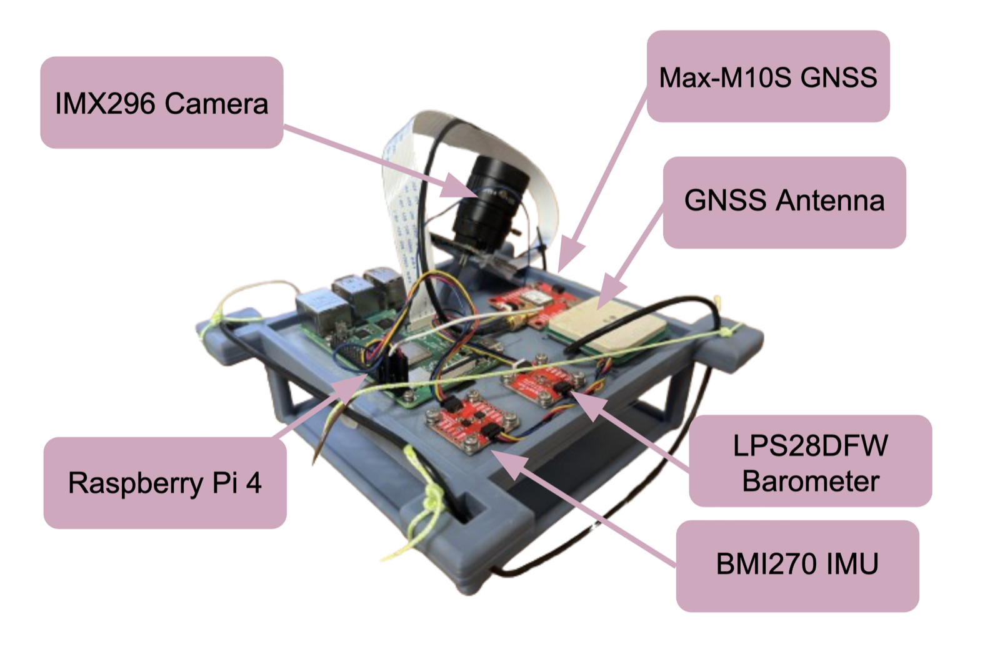
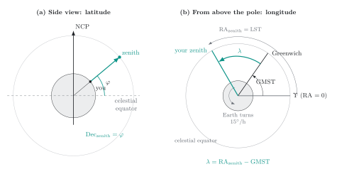
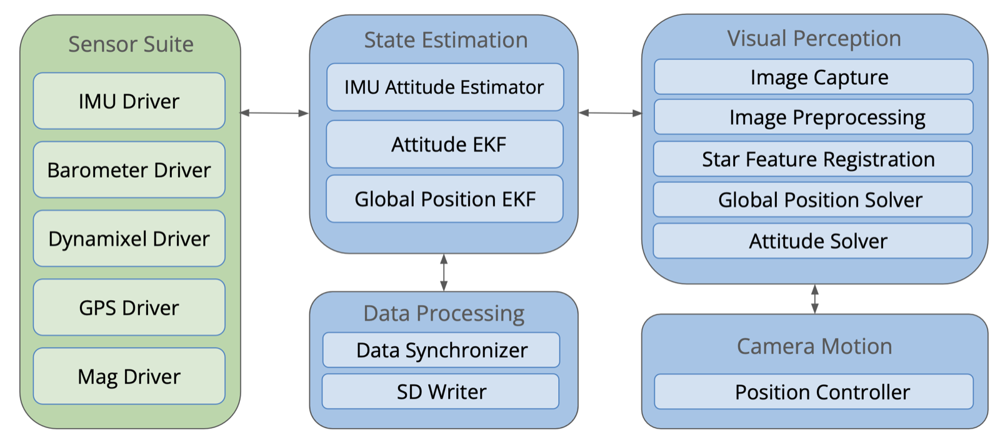
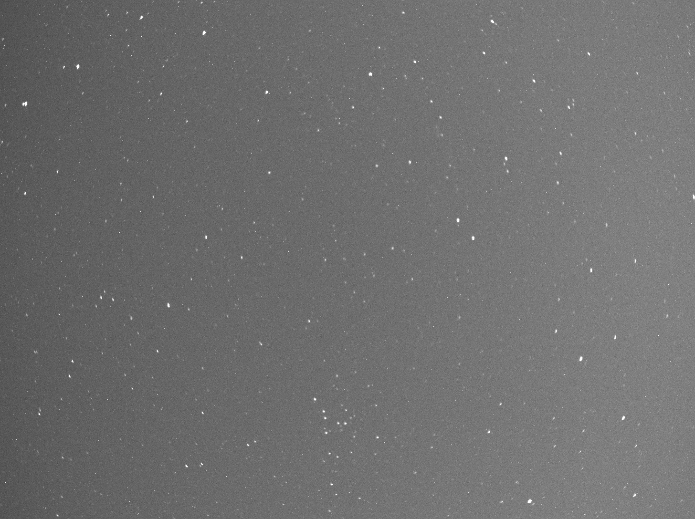
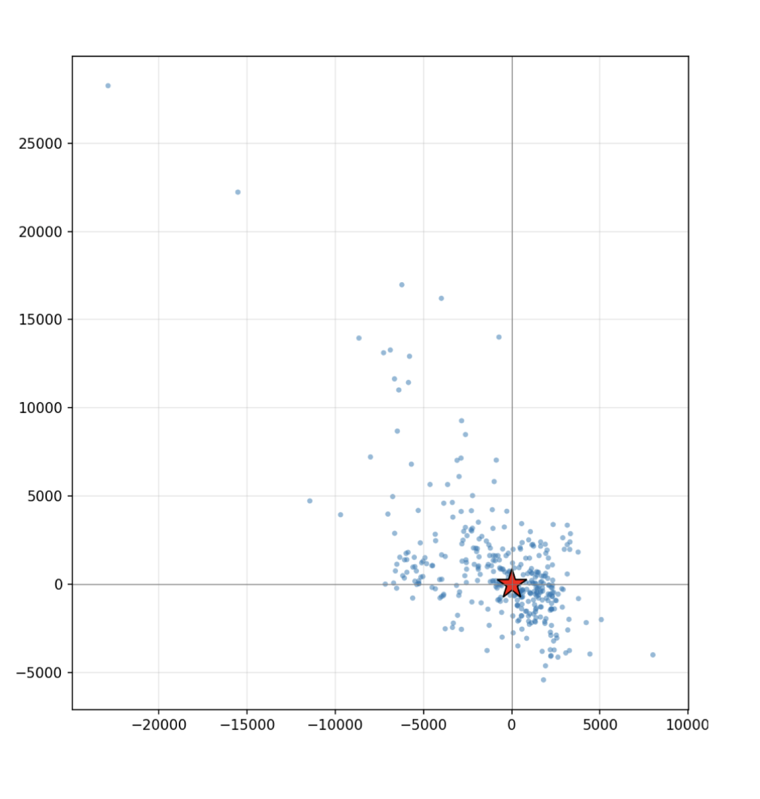
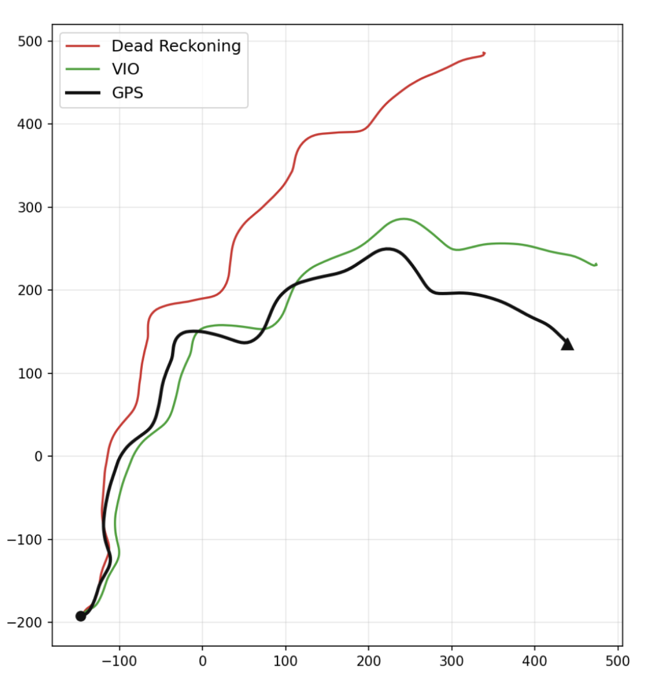
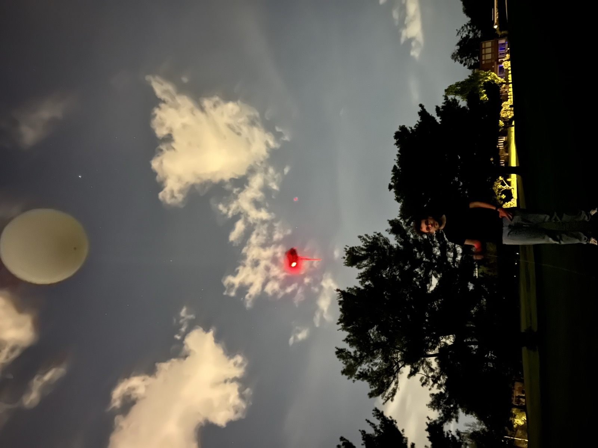
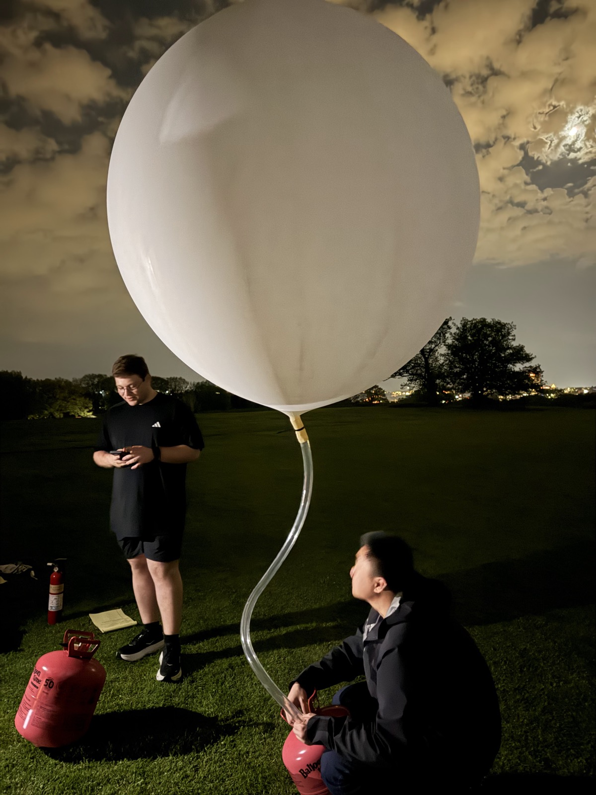
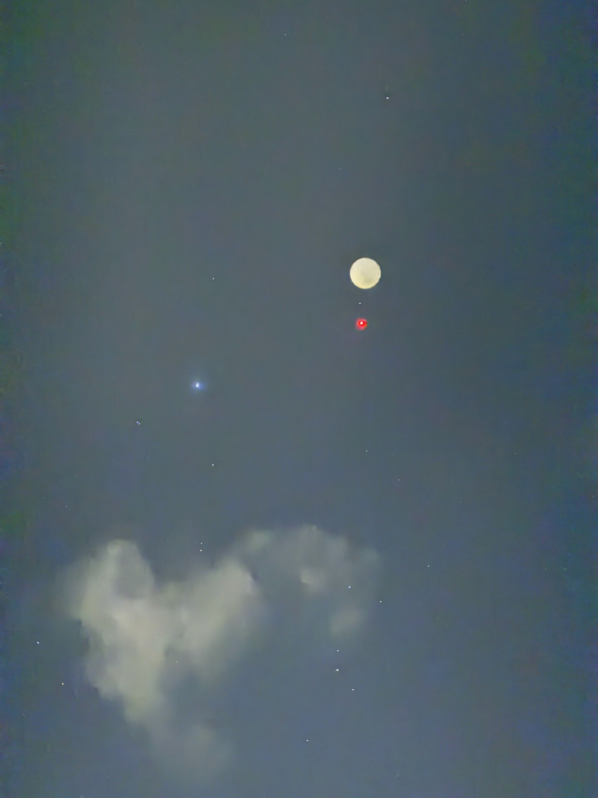

## Overview

When GNSS is unavailable, an inertial navigation system can continue estimating motion, but small errors in attitude and sensor bias accumulate into drift in the attitude estimate. Stars offer an external reference at night, where downfacing cameras may face occlusion from clouds or insufficient illumination of the ground to enable visual navigation on high altitude platforms.

I built a low-cost prototype to investigate whether a star camera could provide useful corrections to an inertial estimate using consumer hardware. The project brought together a fun mix of camera calibration, vision techniques for star detection and identification, sensor fusion, and integration of it all into an embedded computer.

The module achieved a median static position error of **2.1 km**. On a **942 m vehicle trajectory**, adding stellar measurements reduced final position error from **360.4 m to 105 m**, approximately a **3.4× improvement** over inertial dead reckoning.

<figure id="fig:hardware">

<figcaption><strong>Figure 1.</strong> The assembled prototype, with an IMX296 camera, Raspberry Pi, IMU, barometer, and GNSS receiver.</figcaption>
</figure>

## From Stars to Position

A star image provides an orientation reference through *plate solving*. The solver matches the geometric pattern of detected stars against a star catalog, loaded on board the device, then maps image coordinates to directions on the celestial sphere. With calibrated camera intrinsics, corresponding camera-frame and celestial-frame star directions also determine the camera's orientation through a Kabsch alignment.

Recovering geographic position requires another piece of information: the direction of the local zenith, or the point directly overhead. A star image alone gives celestial orientation, so the camera's tilt relative to the Earth must also be known in order to uniquely determine a geodetic coordinate estimate. 

In the simplified geometry shown below, the zenith's declination gives latitude, while its right ascension and the time determine longitude:

$$
\begin{aligned}
\varphi &= \mathrm{Dec}_{\mathrm{zenith}}, \\
\lambda &= \mathrm{RA}_{\mathrm{zenith}} - \mathrm{GMST}.
\end{aligned}
$$

Here, GMST is Greenwich Mean Sidereal Time, which describes Earth's rotation relative to the stars. We also see that any tilt estimation or timestamping errors propogate directly into positioning error.

<figure id="fig:geometry">

<figcaption><strong>Figure 2.</strong> The geometry behind the position fix. Latitude follows from the zenith's declination; longitude follows from its right ascension relative to Greenwich sidereal time.</figcaption>
</figure>

## System and Method

The prototype uses an IMX296 global-shutter monochrome camera with a 6 mm lens, a Raspberry Pi 4, a BMI270 IMU, and an LPS28DFW barometer. A MAX-M10S GNSS receiver supplies validation data and an initial clock synchronization signal after which timestamps rely on the Pi's hardware timer.

I selected a global-shutter sensor to avoid the row-dependent distortion that a rolling shutter introduces when the camera moves during capture. The monochrome sensor also improves sensitivity to faint stars. Camera calibration reached a reprojection error of 0.32 pixels. The assembled module weighs under 280 g, with off-the-shelf hardware costing under $250.

<figure id="fig:system-block-diagram">

<figcaption><strong>Figure 3.</strong> The ROS 2 architecture connects image processing and sensor drivers to coupled attitude and position estimators.</figcaption>
</figure>

### Celestial Observations

The visual pipeline detects bright sources against the image background using thresholding and clustering. It passes the strongest candidates to astrometry.net for identification. Solves took approximately 300–800 ms on the Raspberry Pi.

Once the stars are identified, attitude recovery becomes a geometric alignment problem. For an undistorted star centroid $\tilde{\mathbf{u}}_i = [u_i,v_i,1]^T$ and camera intrinsic matrix $\mathbf{K}$, the corresponding camera-frame ray is

$$
\mathbf{c}_i = \frac{\mathbf{K}^{-1}\tilde{\mathbf{u}}_i}
{\|\mathbf{K}^{-1}\tilde{\mathbf{u}}_i\|}.
$$

The matched celestial direction, expressed using right ascension $\alpha_i$ and declination $\delta_i$, is

$$
\mathbf{s}_i =
\begin{bmatrix}
\cos\delta_i\cos\alpha_i \\
\cos\delta_i\sin\alpha_i \\
\sin\delta_i
\end{bmatrix}.
$$

I recover the camera-to-celestial rotation by aligning these two sets of unit vectors:

$$
\mathbf{R}_{sc}^* = \arg\min_{\mathbf{R}\in SO(3)}
\sum_i \|\mathbf{s}_i-\mathbf{R}\mathbf{c}_i\|^2.
$$

This is the rotation-alignment problem solved by the [Kabsch algorithm](https://www.nist.gov/publications/purely-algebraic-justification-kabsch-umeyama-algorithm). For $\mathbf{M}=\sum_i\mathbf{s}_i\mathbf{c}_i^T=\mathbf{U}\boldsymbol{\Sigma}\mathbf{V}^T$, its solution is $\mathbf{R}_{sc}=\mathbf{U}\,\mathrm{diag}(1,1,\det(\mathbf{U}\mathbf{V}^T))\mathbf{V}^T$. The determinant correction ensures a rotation rather than a reflection.

The report evaluates the alignment using per-star angular residuals:

$$
\epsilon_i = \cos^{-1}\!\left(
\operatorname{clip}\!\left(\mathbf{s}_i^T\mathbf{R}_{sc}\mathbf{c}_i,-1,1\right)
\right).
$$

These residuals measure how well one orientation explains the observed star directions. Solutions with large residuals are rejected before fusion. A small residual indicates a consistent alignment; it does not by itself establish an accurate local vertical or geographic position.

<figure id="fig:star-capture">

<figcaption><strong>Figure 4.</strong> An actual sky image from the module's camera, showing the star field available to the detection and plate-solving pipeline.</figcaption>
</figure>

### Visual-Inertial Odometry (VIO)

The VIO pipeline combines inertial propagation with visual corrections at two rates. Short exposures captured roughly 5–8 star features per image at 10 Hz. Matching those features between frames provided frequent relative-rotation corrections without requiring a full catalog match on every image. About once per second, I combined the rapid exposures into a brighter image and ran the full plate solver to recover an absolute celestial reference.

The key was to compensate for motion before combining the images. Simply adding frames from a moving camera spreads each star across several pixels. I instead estimated the relative camera rotation, dewarped each exposure into a common reference frame, and then stacked the aligned images. In calibrated, undistorted image coordinates, the rotational warp can be written as

$$
\tilde{\mathbf{u}}_{\mathrm{ref}} \sim
\mathbf{K}\mathbf{R}_{\mathrm{ref}\leftarrow j}\mathbf{K}^{-1}
\tilde{\mathbf{u}}_j,
$$

where $\mathbf{R}_{\mathrm{ref}\leftarrow j}$ maps rays from exposure $j$ into the reference camera frame and $\sim$ denotes equality up to homogeneous scale. 

This let the same stream of rapid exposures serve two purposes: sparse frames supplied fast motion corrections, while their aligned stack supplied the stronger star field needed for absolute identification.

### Dual-Filter Estimator

I organized the estimator into two coupled filters. The first estimates orientation; the second estimates position and velocity using that orientation. This separates the attitude corrections from the translational dynamics while allowing both filters to use the absolute reference supplied by a plate solve.

| Input | Rate | Role |
| --- | --- | --- |
| Gyroscope and accelerometer | 100 Hz | Propagate attitude, then position and velocity |
| Matched stars in short exposures | 10 Hz | Correct relative rotation between frames |
| Plate solve of aligned exposures | Approximately 1 Hz | Supply absolute celestial attitude and a geographic position fix |
| Barometer | 10 Hz | Supply an independent altitude constraint |

#### 1. Attitude Filter

At each IMU sample, the attitude filter integrates angular velocity to propagate the body-to-navigation rotation $\mathbf{R}_{nb}$. Accelerometer measurements provide a roll-and-pitch reference through the estimated gravity direction:

$$
\theta_k = \alpha\left(\theta_{k-1}+\omega_k\Delta t\right)
+(1-\alpha)\theta_{\mathrm{acc},k},
\qquad \alpha=0.99.
$$

Here, $\theta_{\mathrm{acc},k}$ is the tilt inferred from the accelerometer.

The short-exposure frontend supplies relative camera rotation at 10 Hz. After accounting for the camera-to-IMU alignment, these observations correct the orientation change tracked by the gyroscope between frames. They provide frequent motion information, while the roughly 1 Hz plate solve supplies the absolute celestial orientation that anchors the estimate over longer intervals. The celestial attitude must be related to the local navigation frame using the timestamp, Earth rotation, and local reference before it can correct $\mathbf{R}_{nb}$.

The output of this filter is the orientation used to interpret accelerometer measurements. It also supplies the tilt information needed to relate the observed star field to the local zenith for geographic positioning.

#### 2. Position and Velocity Filter

For the position stage, let $\mathbf{x}=[\mathbf{p}^T,\mathbf{v}^T]^T$ contain position and velocity in a local navigation frame. Using the attitude filter output, gravity compensation is

$$
\mathbf{a}_n = \mathbf{R}_{nb}\mathbf{a}_{\mathrm{measured}}-\mathbf{g}_{\mathrm{rest}},
$$

where $\mathbf{R}_{nb}$ rotates body-frame measurements into the navigation frame and $\mathbf{g}_{\mathrm{rest}}$ is the expected rotated accelerometer reading at rest. Defining this reference explicitly avoids ambiguity about the gravity sign: a stationary, correctly oriented sensor should give $\mathbf{a}_n\approx\mathbf{0}$. A tilt error of $\delta\theta$ leaves approximately $g\delta\theta$ of spurious horizontal acceleration for small angles, which is why attitude corrections matter so much to fidelity of position estimation.

Over an IMU interval $\Delta t$, the position and velocity prediction is

$$
\mathbf{x}_{k+1}^{-} =
\underbrace{\begin{bmatrix}
\mathbf{I} & \Delta t\,\mathbf{I} \\
\mathbf{0} & \mathbf{I}
\end{bmatrix}}_{\mathbf{F}_k}\mathbf{x}_k^{+}
+
\underbrace{\begin{bmatrix}
\tfrac12\Delta t^2\mathbf{I} \\
\Delta t\,\mathbf{I}
\end{bmatrix}}_{\mathbf{G}_k}\mathbf{a}_{n,k},
\qquad
\mathbf{P}_{k+1}^{-}=\mathbf{F}_k\mathbf{P}_k^{+}\mathbf{F}_k^T+\mathbf{Q}_k.
$$

Note that although attitude and geographic coordinate conversion are nonlinear, this position-and-velocity propagation is linear once the acceleration estimate is supplied.

## Results

### Static Positioning

In outdoor testing in San Jose, California, the system achieved a **2.1 km median position error** and a **6.8 km 95th-percentile error** against GNSS ground truth. Clear-sky images consistently contained more than eight detected stars. These results demonstrate kilometer-scale absolute positioning with inexpensive hardware, while also showing the sensitivity to orientation and measurement quality.

<figure id="fig:static-results">

<figcaption><strong>Figure 5.</strong> Position estimates from individual exposures in the static test. Axes are in meters, and the red star marks ground truth.</figcaption>
</figure>

### Moving-Vehicle Test

I evaluated the VIO pipeline and dual-filter estimator on a moving vehicle. I compared inertial-only dead reckoning and the stellar-inertial estimator on the same recorded sensor data, using time-aligned GNSS as ground truth. Over the 942 m trajectory, final position error was **105 m with stellar updates**, compared with **360.4 m using dead reckoning alone**.

This measures drift reduction over one trajectory, rather than the accuracy of an individual stellar fix. It should therefore be read separately from the static positioning result. The test shows that the combined estimator improved the final estimate in this run; longer and more varied trajectories are needed to characterize that benefit more broadly.

<figure id="fig:trajectories">

<figcaption><strong>Figure 6.</strong> The moving-vehicle test. The stellar-inertial estimate follows the reference trajectory more closely than inertial dead reckoning.</figcaption>
</figure>

## Moored Weather Balloon Test

I also built and launched a moored weather balloon setup carrying the module. We used a 96-inch (8-foot) balloon, tethered to the ground, to take the hardware into the air for a nighttime test.

<figure id="fig:balloon-launch">

<figcaption><strong>Figure 7.</strong> Me with the balloon and suspended module during the launch.</figcaption>
</figure>

Weather got in the way, and we were unable to extract useful navigation results from the flight. The quantitative results above therefore come from the ground tests. Still, I had a ton of fun building the setup and getting it airborne. I also got to work through the FAA Part 101 paperwork and NOTAM coordination for the flight—a part of the project that took me well beyond the camera and estimator code. The FAA describes that notification process in its [guidance for moored balloon operations](https://www.faa.gov/air_traffic/publications/atpubs/foa_html/chap19_section_5.html).

<figure id="fig:balloon-field-test" class="photo-pair">
<figure>

<figcaption>Filling the 96-inch balloon before launch.</figcaption>
</figure>
<figure>

<figcaption>The balloon and module airborne.</figcaption>
</figure>
<figcaption><strong>Figure 8.</strong> Preparing the balloon and flying the module on its tether.</figcaption>
</figure>

## Selected References

Teague, S., and J. Chahl. 2024. “An algorithm for affordable vision-based GNSS-denied strapdown celestial navigation.” *Drones* 8 (11): 652. doi: 10.3390/drones8110652.

Parish, J. J., A. S. Parish, M. Swanzy, D. Woodbury, D. Mortari, and J. L. Junkins. 2010. “Stellar positioning system (Part I): An autonomous position determination solution.” *NAVIGATION* 57 (1): 1–12.

Lang, D., D. W. Hogg, K. Mierle, M. Blanton, and S. Roweis. 2010. “Astrometry.net: Blind astrometric calibration of arbitrary astronomical images.” *The Astronomical Journal* 139 (5): 1782–1800. doi: 10.1088/0004-6256/139/5/1782.
