## Overview

Speech recognition models trained with Connectionist Temporal Classification (CTC) output a distribution over tokens at each audio frame. A decoder combines these distributions into a transcription, accounting for the different alignments that can produce the same text. In the CPU implementations we compare against, Flashlight and pyctcdecode, decoding requires transferring the acoustic model's outputs from GPU to CPU before searching over possible transcriptions.

We implemented the decoding loop in CUDA, including hypothesis expansion, merging of duplicate prefixes, and pruning. The decoder processes several utterances in a batch and evaluates candidate extensions in parallel. The main difficulty in parallelizing inference is that the search changes at every time step - hypotheses branch, several paths can produce the same prefix, and only a subset of candidates survives. We organize this work into operations over flat arrays so that it can run efficiently on the GPU.

On the LibriSpeech benchmarks described below, our decoder reaches more than 2× the throughput of batched pyctcdecode at large batch sizes and exceeds 5000 seconds of audio decoded per second of computation. These measurements cover decoding only, excluding the acoustic model. We also evaluate adaptive beam widths, which reduce decoding time by roughly 2× relative to our fixed-width CUDA implementation in the tested configurations.

## CTC Decoding

CTC (Graves et al. 2006) allows a model to learn from paired audio and transcriptions without knowing which audio frames correspond to each output token. There are typically many more frames than tokens. CTC handles this mismatch by allowing repeated tokens and introducing a blank token $\epsilon$, which emits no output token at that frame.

Given an input $\mathbf{X}$, the acoustic model outputs log-probabilities over the vocabulary $\mathcal{V} = \mathcal{L} \cup \{\epsilon\}$ at each of $T$ time steps, where $\mathcal{L}$ is the set of non-blank tokens and $V = |\mathcal{V}|$. Our decoder takes these values as a tensor $\mathbf{P} \in \mathbb{R}^{B \times T \times V}$ for a batch of $B$ utterances. For one utterance, omitting the batch index, $\mathbf{P}_{t,c} = \log P(\pi_t = c \mid \mathbf{X})$.

A path $\pi = (\pi_1, \dots, \pi_T)$ assigns a token or blank to each frame. CTC assumes these assignments are conditionally independent given the input, so the path's log-probability is

$$
\log P(\pi \mid \mathbf{X}) = \sum_{t=1}^T \mathbf{P}_{t, \pi_t}. \tag{1}
$$

A collapse function $\mathcal{B}: \mathcal{V}^T \to \mathcal{L}^{\le T}$ maps paths to output sequences by first removing repeated adjacent tokens and then removing blanks. For instance (example from Raj 2025), the path $\pi^{(1)} = \texttt{RRR---EE---DDD}$ maps to "RED", while $\pi^{(2)} = \texttt{RR-E--EED}$ maps to "REED" - the blank is what distinguishes a repeated letter from a held one.

<figure class="added">
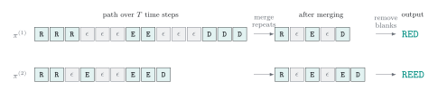
<figcaption><strong>Figure 1.</strong> The collapse $\mathcal{B}$ on the two example paths: merging repeated tokens and then removing blanks ($\epsilon$) turns $\pi^{(1)}$ into RED and $\pi^{(2)}$ into REED. The blank between the two Es is what keeps them from merging.</figcaption>
</figure>

Several paths can collapse to the same transcription. The probability of a transcription is therefore the sum of the probabilities of all paths that produce it. Decoding seeks the transcription with the largest total probability:

$$
\mathbf{l}^* = \mathop{\mathrm{argmax}}_{\mathbf{l} \in \mathcal{L}^{\le T}} \sum_{\pi \in \mathcal{B}^{-1}(\mathbf{l})} P(\pi \mid \mathbf{X}). \tag{2}
$$

Greedy decoding selects the most probable token at each frame, $\hat{\pi}_t = \arg\max_{c \in \mathcal{V}} \mathbf{P}_{t,c}$, and collapses the resulting path. This is inexpensive, but the most probable individual path need not produce the most probable transcription. Prefix beam search approximates the search by retaining at most $W$ output prefixes at each step. It extends them with candidate tokens, combines the probabilities of paths that produce the same prefix, and keeps the $W$ highest-scoring prefixes. We refer to $W$ as the beam width.

CTC decoding uses acoustic probabilities computed in a single model forward pass. It does not need to run the model again for each candidate extension. Although successive decoding steps depend on one another, candidates within a step and utterances within a batch can be processed in parallel.

## Parallelizing the Search

At each time step, up to $W$ active prefixes expand into $W \times V$ candidates per utterance. Each candidate can be scored independently, providing parallel work across both prefixes and utterances. Merging and selecting those candidates is less straightforward. GPUs execute groups of threads together, and work best when those threads follow similar instructions (thread divergence) and access nearby memory locations (exploiting memory locality). A dynamic search introduces several difficulties:

- **Irregular memory access.** Beam search traverses a dynamic prefix tree. As hypotheses fork and merge, tree- or linked-list-based storage of prefixes, scores, and parent pointers fragments into sparse, indirect access patterns with poor cache locality and uncoalesced global memory transactions.

- **Prefix merging.** Different paths collapse to the same prefix (`ABB-` and `AB--` both yield "AB"), and their probabilities must be summed. Finding and reducing identical prefixes among $W \times |\mathcal{V}|$ candidates is hard to parallelize without heavy synchronization or data movement.

- **Load imbalance.** The number of candidates that merge into each unique prefix varies widely across prefixes and time steps, and the number of survivors fluctuates - especially once the beam width itself adapts.

- **Top-$W$ selection** over up to $W \times |\mathcal{V}|$ candidates becomes expensive for large vocabularies.

Algorithm 1 summarizes the decoding loop. Our implementation focuses on parallelizing hypothesis expansion and the merge-and-prune stages.

<figure id="alg:ctc_beam_search" class="algorithm">

</figure>

## Method

### Flat Hypothesis State and Packed Keys

Our first implementation stored each candidate as a separate integer array, copying the parent sequence and appending a token at every expansion. This incurred substantial copying and memory costs. A pointer-based prefix tree reduced memory use, but sorting and pruning remained slow, possibly because threads followed different paths through the tree.

In the final design, active hypotheses are stored in contiguous arrays, with separate arrays for each state field. This structure-of-arrays layout lets neighboring threads access neighboring entries, allowing the GPU to combine their memory accesses into fewer transactions (Fig. 2).

<figure id="fig:memory_layout">
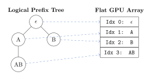
<figcaption><strong>Figure 2.</strong> Mapping of the logical dynamic prefix tree to a static flat array structure in GPU global memory to enable coalesced access.</figcaption>
</figure>

To group candidates that represent the same output prefix, we assign each candidate an integer key containing its batch index and a rolling hash of its prefix. The batch index keeps candidates from different utterances separate; the hash lets us compare prefixes without traversing their full token sequences. For batch index $b \in \{0,\dots,B-1\}$ and prefix $c_1,\dots,c_L$, the hash is updated as

$$
h_0 = 0,\qquad
h_t = (\alpha h_{t-1} + (c_t + 1)) \bmod 2^{32}, \quad t = 1,\dots,L,
$$

with $\alpha = 33$, following a DJB2-style update. The packed key is also 32 bits wide. We allocate enough high bits to identify the utterance within the batch and use the remaining low bits for the prefix hash:

$$
k_{\text{batch}} = \left\lceil \log_2 B \right\rceil,\qquad
k_{\text{hash}} = 32 - k_{\text{batch}},\qquad
\text{key} = (b \ll k_{\text{hash}}) \;\big|\; \bigl(h_t \;\&\; (2^{k_{\text{hash}}} - 1)\bigr).
$$

Sorting by this key brings candidates with the same batch index and truncated hash together, so their probabilities can be combined with a parallel reduction. Of course, this is an approximation; distinct prefixes can have hash collisions and be merged incorrectly. An early implementation reserved 16 bits each for the batch index and hash, and collisions measurably affected accuracy. Allocating only the necessary bits to the batch index leaves more room for the hash, reducing this problem. Larger batches still leave fewer hash bits, a tradeoff we revisit in the results.

<figure id="fig:packed_key">

<figcaption><strong>Figure 3.</strong> Bit-wise layout of the packed key used for parallel sorting.</figcaption>
</figure>

### Kernel Pipeline

Each time step applies the following operations to the hypothesis buffers (Fig. 4). We use custom CUDA kernels for token pruning, expansion, and selection, and Thrust library operations for sorting, reduction, and gathering.

1. **Token pruning.** A kernel selects the top $K$ tokens from each utterance's acoustic distribution at the current frame. Expanding only these tokens reduces the candidate set from $W \times V$ to at most $W \times K$ per utterance. Shared-memory reductions reduce accesses to global memory.

2. **Expansion.** Each candidate extension is assigned to a thread. The decoder tracks separate scores for paths ending in a blank and paths ending in a non-blank token. This distinction is needed for repeated tokens: another copy of the last token creates a new output token only when separated from the previous copy by a blank. Otherwise, it contributes to the existing prefix. Each thread applies these transition rules and updates the candidate's scores and hash. Invalid extensions are marked for exclusion.

3. **Merge.** `thrust::sort_by_key` groups candidates with equal keys. `thrust::reduce_by_key` combines their probability contributions, and `thrust::gather` collects the corresponding auxiliary state.

4. **Beam pruning.** Candidates are sorted by score within each batch segment. A `top_k` kernel locates each segment and copies its best $W$ candidates into the buffers for the next step. Parent indices and tokens are recorded in a history buffer; after the final frame, a reconstruction kernel follows this history to recover the output sequences.

<figure id="fig:gpu_pipeline">
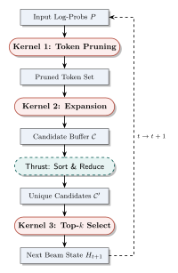
<figcaption><strong>Figure 4.</strong> The GPU kernel pipeline. The process alternates between custom CUDA kernels (red) and Thrust library primitives (green) to transform data residing in global memory buffers (purple).</figcaption>
</figure>

<figure id="fig:warp_mapping_final">
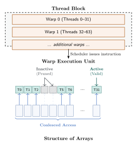
<figcaption><strong>Figure 5.</strong> Mapping of CUDA kernels to hardware warps.</figcaption>
</figure>

### Adaptive Beam Width

A fixed beam width spends the same search effort at every frame, even when only a few candidates have substantial probability. We explored reducing the beam width as decoding progresses, using the entropy of the acoustic token distribution as a measure of uncertainty. In our observations, token entropy tended to decrease approximately exponentially, motivating the schedule

$$
w(t) = Ae^{Bt} + C
$$

with a minimum beam width. Here, $t$ is the decoding step and $A$, $B$, and $C$ control the initial width, decay rate, and offset; the coefficient $B$ is unrelated to batch size. We compare three ways of choosing the schedule:

- **Static decay.** A predetermined exponential schedule uses an initial width, an optional hold period, and a minimum width. It reduces work over time but does not respond to the observed entropy. This is distinct from the fixed-width decoder used as a baseline in the results.

- **Lookup table (LUT).** A two-dimensional table stores precomputed decay parameters for discretized time and entropy values. A smoothed entropy history determines which entry to use. Lookup is inexpensive, although discretization limits the schedule's precision.

- **Multilayer perceptron (MLP).** A small learned model maps three entropy measurements to normalized outputs $(\alpha, \beta, \gamma)$, which are converted to $(A, B, C)$. We compare hidden-layer sizes in Table 1 and use a model with two hidden neurons.

<strong>Table 1.</strong> Architecture search for the entropy MLP scheduler.

| **Hidden** | **MSE** | **MAE** | **MLP (ns)** | **LUT (ns)** | **Ratio** | **Memory** |
|---:|---:|---:|---:|---:|---:|---:|
| 16 | 0.000105 | 0.006853 | 77.2 | 5.0 | 15.44$\times$ | 460 B |
| 12 | 0.000108 | 0.006923 | 83.1 | 5.0 | 16.62$\times$ | 348 B |
| 8 | 0.000064 | 0.004631 | 68.6 | 4.8 | 14.29$\times$ | 236 B |
| 6 | 0.000109 | 0.007175 | 65.8 | 5.0 | 13.16$\times$ | 180 B |
| 4 | 0.000108 | 0.006934 | 56.1 | 5.0 | 11.22$\times$ | 124 B |
| 3 | 0.000148 | 0.007807 | 55.4 | 5.3 | 10.45$\times$ | 96 B |
| 2 | 0.000104 | 0.006970 | 50.0 | 5.3 | 9.43$\times$ | 68 B |
| 1 | 0.016631 | 0.096473 | 48.5 | 4.8 | 10.10$\times$ | 40 B |

In the synthetic entropy-history evaluation, the MLP predicts the target decay parameters more accurately than the LUT (Figs. 6–7). Its errors are more concentrated around zero, and its predicted schedules follow the reference curves more closely. Some LUT schedules shrink the beam faster than the reference, which could discard useful hypotheses too early.

The MLP also takes about an order of magnitude longer to query than the LUT. These parameter-prediction results do not directly establish transcription accuracy or decoding speed, so we evaluate both schedulers in the full decoder below.

<figure id="fig:accuracy">
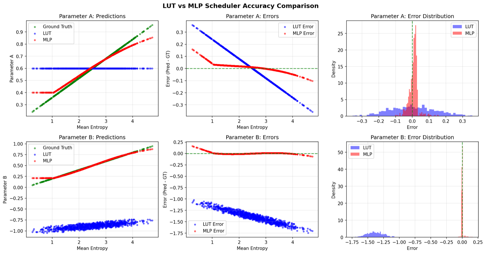
<figcaption><strong>Figure 6.</strong> LUT vs. MLP accuracy for the decay parameters $A, B$, evaluated on 1000 synthetic entropy histories at time step $t = 50$.</figcaption>
</figure>

<figure id="fig:decay">
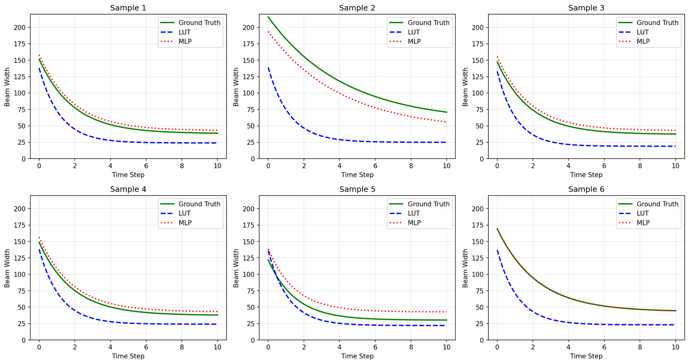
<figcaption><strong>Figure 7.</strong> Representative exponential beam-width schedules $f(x) = Ae^{Bx} + C$, comparing ground truth to the LUT and MLP predictions, with $W_{min} = 10$ and $W_{max} = 200$.</figcaption>
</figure>

## Results

We evaluate Wav2Vec2 (Baevski et al. 2020) outputs on the LibriSpeech `test-other` set (Panayotov et al. 2015), using `WAV2VEC2_ASR_BASE_960H` with its 29-token vocabulary. All timings exclude the acoustic model's forward pass. Benchmarks ran on a laptop with an NVIDIA GeForce RTX 5070 Ti Laptop GPU and an Intel Core Ultra 9 275HX CPU (24 cores, up to 5.4 GHz).

We report throughput as audio duration divided by decoding time, denoted RTFx. For example, 100 RTFx means that one second of decoding processes 100 seconds of audio. Accuracy is measured using word error rate (WER) and character error rate (CER), where lower values are better.

We compare against the CPU decoders Flashlight (Kahn et al. 2016), through TorchAudio's C++ backend, and pyctcdecode (Technologies 2022), in sequential and batched modes. We did not obtain a runnable GPU baseline for this project: the experimental TorchAudio GPU decoder was unavailable in our setup, and we were unable to run NVIDIA's FlexCTC as a standalone decoder. The results therefore compare our GPU implementation with these CPU baselines.

<figure id="fig:testing_pipeline">
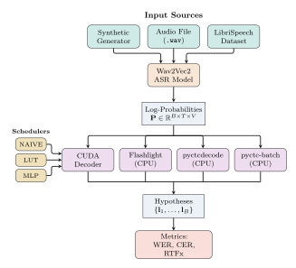
<figcaption><strong>Figure 8.</strong> Evaluation data flow. Input sources (green) feed the Wav2Vec2 acoustic model (orange), producing log-probability tensors. The CUDA decoder (pink, left) accepts adaptive beam width schedulers (yellow), while the CPU baselines are Flashlight, pyctcdecode, and pyctcdecode-batched. All outputs are scored with standard ASR metrics (red).</figcaption>
</figure>

### Beam Width

We first vary beam width with batch size $B = 32$ over 200 samples. Flashlight's decoding time rises from about 0.6 s at $W = 10$ to over 10 s at $W = 100$. The CUDA variants grow more slowly, reaching roughly 1 s in this experiment. The LUT-scheduled variant is fastest among our implementations, while the fixed-width variant is slowest (Fig. 9). This suggests that parallel expansion and reduction absorb much of the additional work from a wider beam over the tested range.

<figure id="fig:time_vs_beam_width">
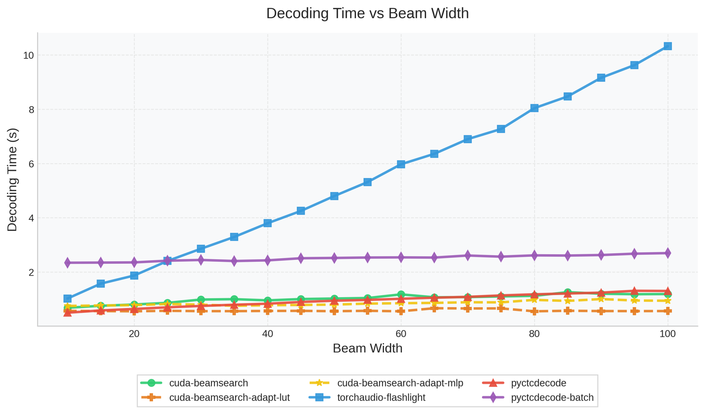
<figcaption><strong>Figure 9.</strong> Total decoding time as a function of beam width $W$, CUDA vs. CPU baselines. Batch size $B = 32$, 200 samples.</figcaption>
</figure>

At $W = 10$, pyctcdecode has the highest throughput, approximately 2100 RTFx. The smaller search offers less work over which to spread GPU overhead. By $W = 100$, its throughput falls by about half, while the LUT-scheduled CUDA decoder remains around 1750–1900 RTFx across the tested range (Fig. 10). Wider beams therefore have a relatively small measured cost for this CUDA variant, though this need not hold at larger widths.

<figure id="fig:rtfx_vs_beam_width">
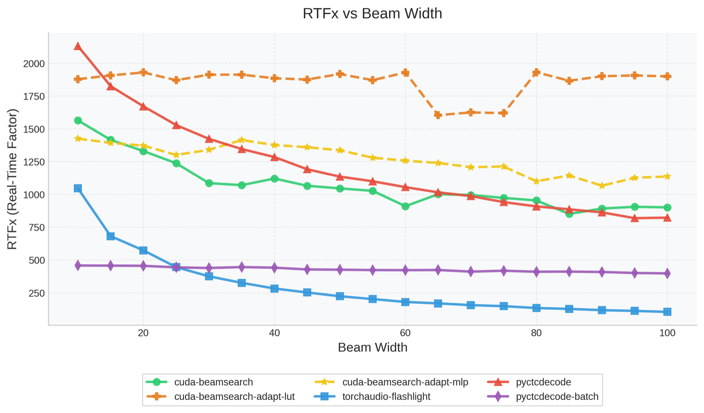
<figcaption><strong>Figure 10.</strong> Real-time factor as a function of beam width $W$. Batch size $B = 32$, 200 samples.</figcaption>
</figure>

Across the tested beam widths, our decoders achieve comparable or lower WER and CER than the CPU baselines (Fig. 11). The LUT variant is the most consistent, while the MLP variant reaches the lowest observed WER. Flashlight has slightly higher error rates in these runs.

<figure id="fig:beam_accuracy">
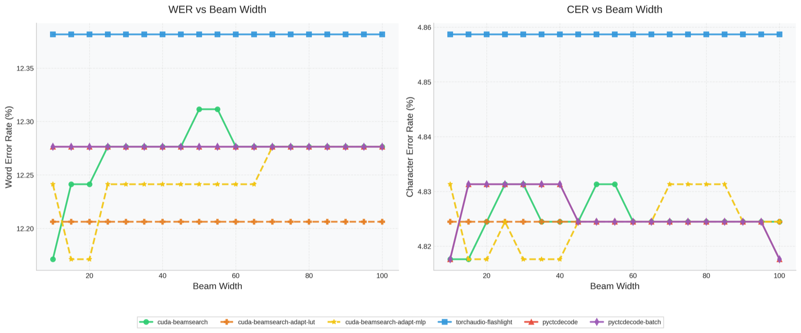
<figcaption><strong>Figure 11.</strong> WER and CER as a function of beam width $W$. Batch size $B = 32$, 200 samples.</figcaption>
</figure>

### Batch Size

We next vary batch size with beam width $W = 50$ over 128 samples (Fig. 12). In our benchmark, batched pyctcdecode creates a new `multiprocessing.Pool` for each pass, while the GPU context is reused. Process startup contributes to the CPU baseline's cost, particularly for small batches, so this comparison reflects the execution setup as well as the search algorithms.

<figure id="fig:batch_size_time">
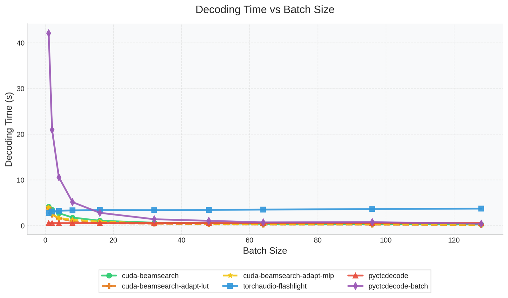
<figcaption><strong>Figure 12.</strong> Decoding latency as a function of batch size. Beam width $W = 50$, 128 samples.</figcaption>
</figure>

Batched pyctcdecode's throughput increases little beyond $B = 64$, while CUDA throughput continues to grow over the tested range (Fig. 13). At the largest batch that fits in GPU memory, our decoder exceeds 5000 RTFx. At the smallest batch sizes, a CPU decoder is still faster: there is less parallel work available to offset kernel-launch and transfer overhead. The experiment shows the benefit of batching, but does not establish how throughput would scale beyond the tested sizes.

<figure id="fig:rtfx_vs_batch_size">
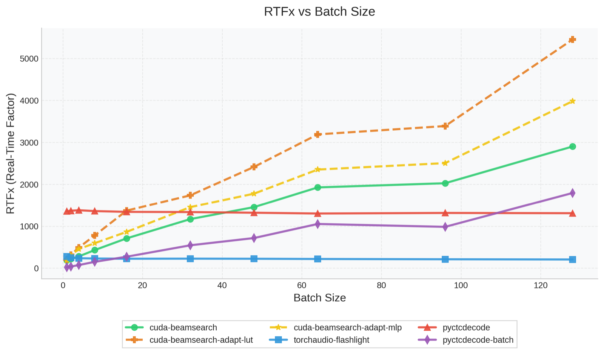
<figcaption><strong>Figure 13.</strong> Real-time factor as a function of batch size $B$. Beam width $W = 50$, 128 samples.</figcaption>
</figure>

Error rates increase slightly as batch size grows (Fig. 14). One likely contributor is the packed key: larger batches require more bits for the batch index, leaving fewer bits for the prefix hash and increasing the chance of incorrect merges. The trend is consistent with that explanation, though this experiment does not isolate hashing from other effects. Accuracy remains comparable to or better than the CPU baselines over the tested range.

<figure id="fig:batch_accuracy">
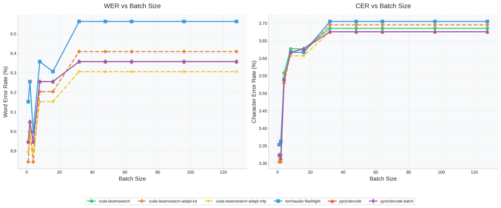
<figcaption><strong>Figure 14.</strong> WER and CER as a function of batch size $B$. Beam width $W = 50$, 128 samples.</figcaption>
</figure>

### Overall Speedup

Figure 15 summarizes the relative speedups. Against Flashlight, the CUDA implementation reaches about 9× at $W = 100$ in the beam-width experiment and about 14× at $B = 128$ in the batch-size experiment. Against batched pyctcdecode, speedup is approximately 2× at large batch sizes.

Within the CUDA implementation, both adaptive schedulers outperform the fixed-width baseline, with the LUT variant roughly 2× faster in the tested configurations. This is a separate comparison from the CPU speedups: it measures the benefit of adjusting beam width within our decoder.

<figure id="fig:cuda_speedup">
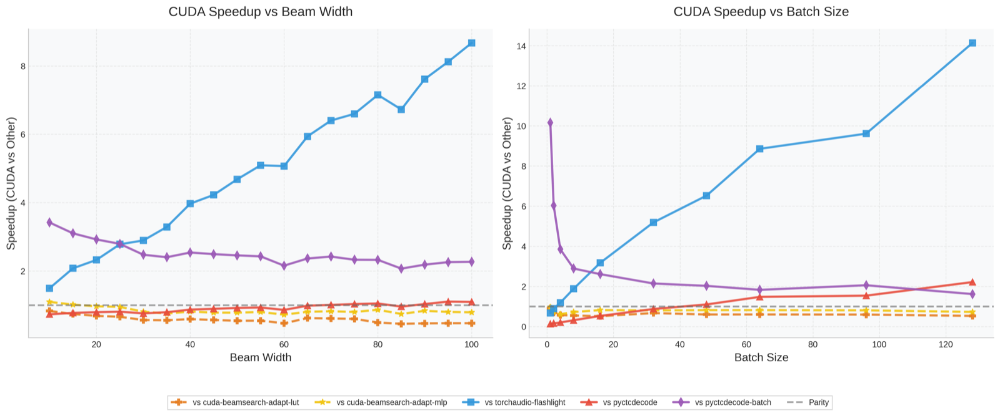
<figcaption><strong>Figure 15.</strong> Speedup of the CUDA implementation over CPU baselines across beam width (left) and batch size (right).</figcaption>
</figure>

## Limitations

- **Memory allocation.** State and history buffers are preallocated for the maximum sequence length. This keeps storage contiguous but limits batch and sequence sizes to what fits in GPU memory. Allocating buffers to match each batch's sequence lengths could reduce unused storage.

- **Hash collisions.** Packing the batch index and prefix hash into 32 bits makes collisions more likely as batch size grows. Wider keys could reduce collisions at the cost of additional memory traffic, though they would not eliminate the possibility of collisions entirely.

- **Vocabulary size.** Token pruning loads the vocabulary distribution into shared memory, limiting the current implementation to vocabularies of at most a few thousand tokens. Our experiments use only 29 tokens, so they do not establish performance for substantially larger vocabularies.

- **Batch-wide schedules.** The adaptive scheduler uses average entropy across the batch. Utterances with different levels of uncertainty therefore receive the same beam width. Per-utterance schedules could allocate search effort more precisely, but would also introduce less uniform work across threads.

## References

Baevski, Alexei, Yuhao Zhou, Abdelrahman Mohamed, and Michael Auli. 2020. “Wav2vec 2.0: A Framework for Self-Supervised Learning of Speech Representations.” *Advances in Neural Information Processing Systems* 33: 12449–60.

Graves, Alex, Santiago Fernández, Faustino Gomez, and Jürgen Schmidhuber. 2006. “Connectionist Temporal Classification: Labelling Unsegmented Sequence Data with Recurrent Neural Networks.” *Proceedings of the 23rd International Conference on Machine Learning*, 369–76.

Kahn, Jacob, Vineel Vineet, Vineel Pratap, et al. 2016. “Flashlight: Enabling Innovation in Speech Recognition.” *Proceedings of the 33rd International Conference on Machine Learning*.

Kuchaiev, Oleksii, Jason Li, Huyen Nguyen, et al. 2019. “NeMo: A Toolkit for Building AI Applications Using Neural Modules.” *arXiv Preprint arXiv:1909.09577*.

Panayotov, Vassil, Guoguo Chen, Daniel Povey, and Sanjeev Khudanpur. 2015. “Librispeech: An ASR Corpus Based on Public Domain Audio Books.” *2015 IEEE International Conference on Acoustics, Speech and Signal Processing (ICASSP)*, 5206–10. <https://doi.org/10.1109/ICASSP.2015.7178964>.

Raj, Bhiksha. 2025. *Deep Learning: Sequence to Sequence Models - Connectionist Temporal Classification*. Lecture Slides, Fall 2025.

Technologies, Kensho. 2022. “Pyctcdecode: A Fast and Feature-Rich CTC Beam Search Decoder for Speech Recognition.” GitHub repository. <https://github.com/kensho-technologies/pyctcdecode>.
